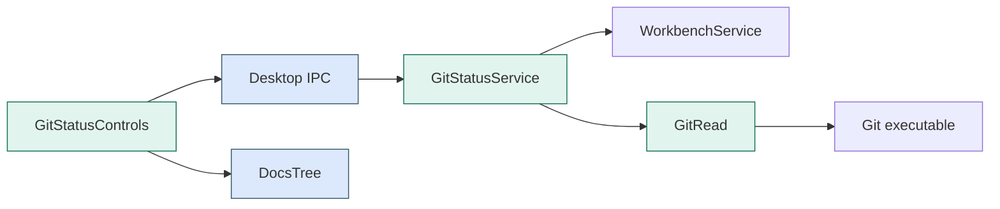
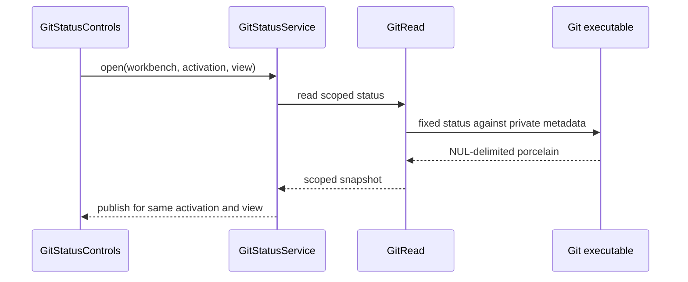
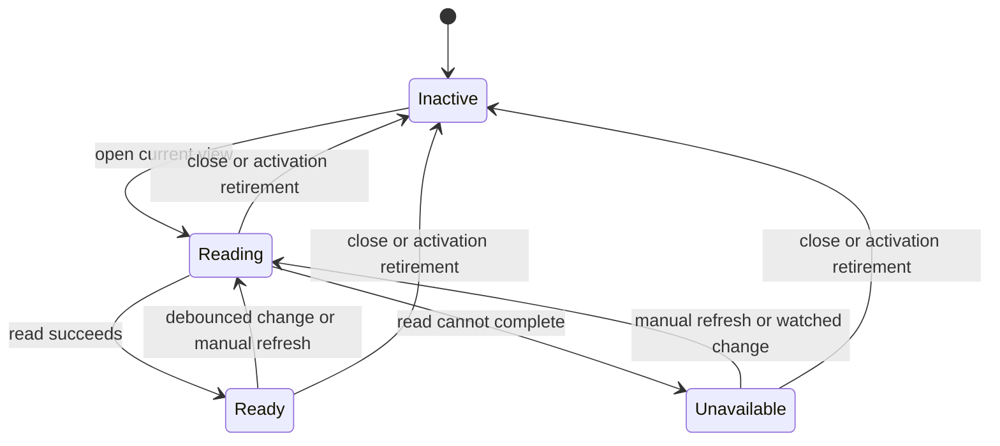

# TASK-64b42980 diagrams

Illustrates the Design in TASK-64b42980.md.

## Structure

Added: GitStatusService, GitRead, GitStatusControls. Changed: DocsTree, Desktop IPC.
Reused: WorkbenchService, Git executable.

## Sequence

## State

