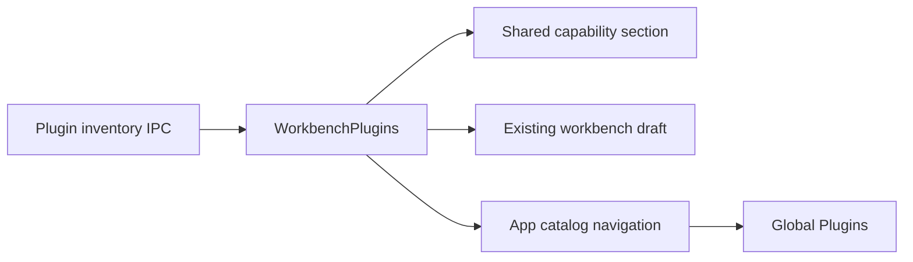
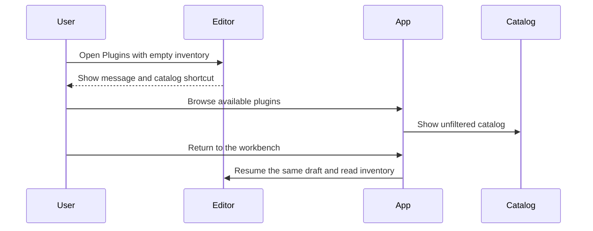

# TASK-66225463 diagrams

Illustrates Design in TASK-66225463.md.

## Structure

Changed: WorkbenchPlugins, WorkbenchSharedCapabilities and App's navigation. Reused: Plugins catalog, plugin inventory IPC and tool allowance storage.

## Sequence

## State

Not drawn: the installed-package and draft lifecycles are unchanged.
