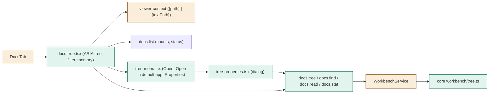
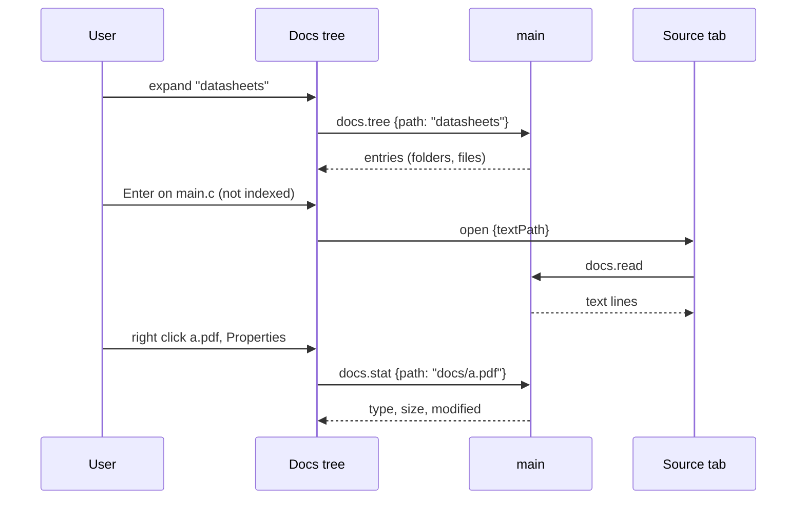

# TASK-66b7d4aa diagrams

Illustrates `## Design` in `TASK-66b7d4aa.md`. The Design text is authoritative.

| Node | Class |
|---|---|
| core workbench/tree.ts, docs.tree/find/read/stat, docs-tree.tsx, tree-menu.tsx, tree-properties.tsx | added |
| WorkbenchService, DocsTab, viewer-context ViewerTarget, mockApi | changed |
| docs.list, docs.open, OpenExternally, readIgnorePolicy | unchanged (reused) |

## Structure

## Sequence

## State

Not drawn: the expanded set is a persisted list of folder paths.
