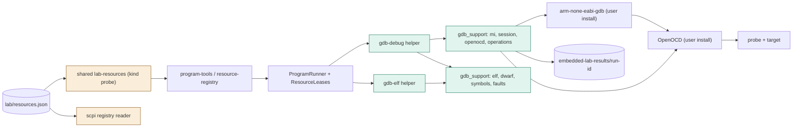
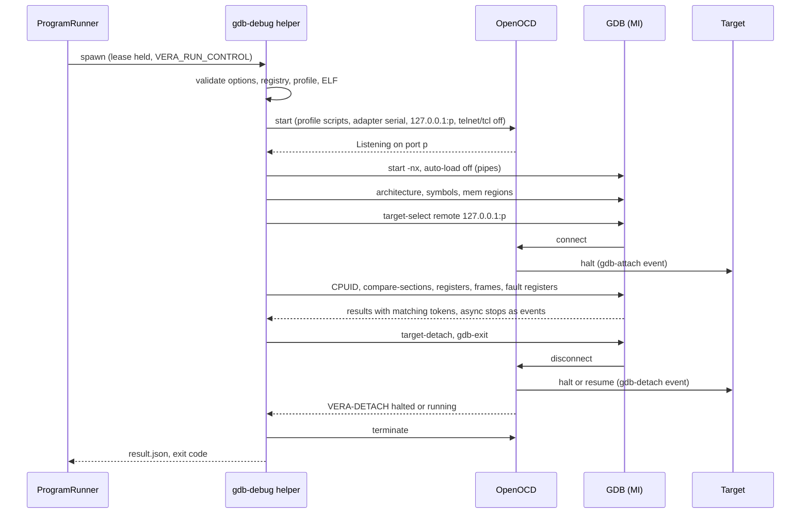
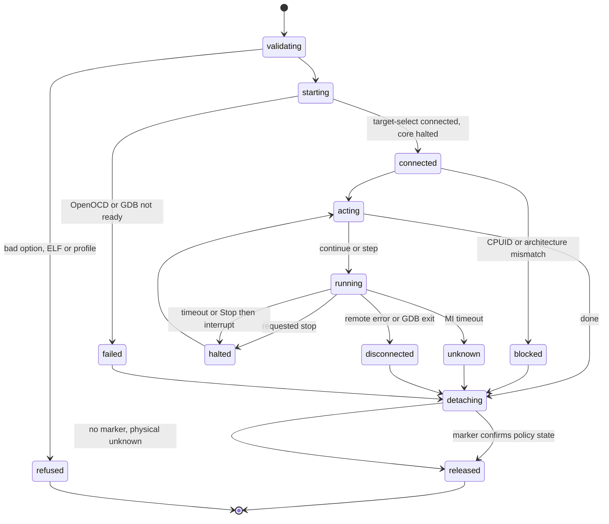

# TASK-6b092dfc diagrams

Illustrates `## Design` in `TASK-6b092dfc.md`. The Design text is authoritative.

Node classes: added - gdb-debug package (gdb-elf and gdb-debug helpers, gdb_support modules, profiles); changed -
shared lab-resources (kind probe), scpi registry reader (skips probe entries); unchanged - program-tools /
resource-registry, ProgramRunner and ResourceLeases, the user's GDB and OpenOCD.

## Structure

## Sequence

## State

