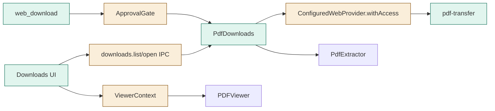
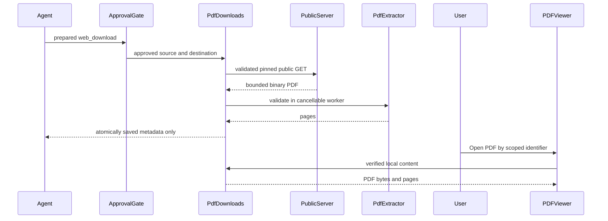
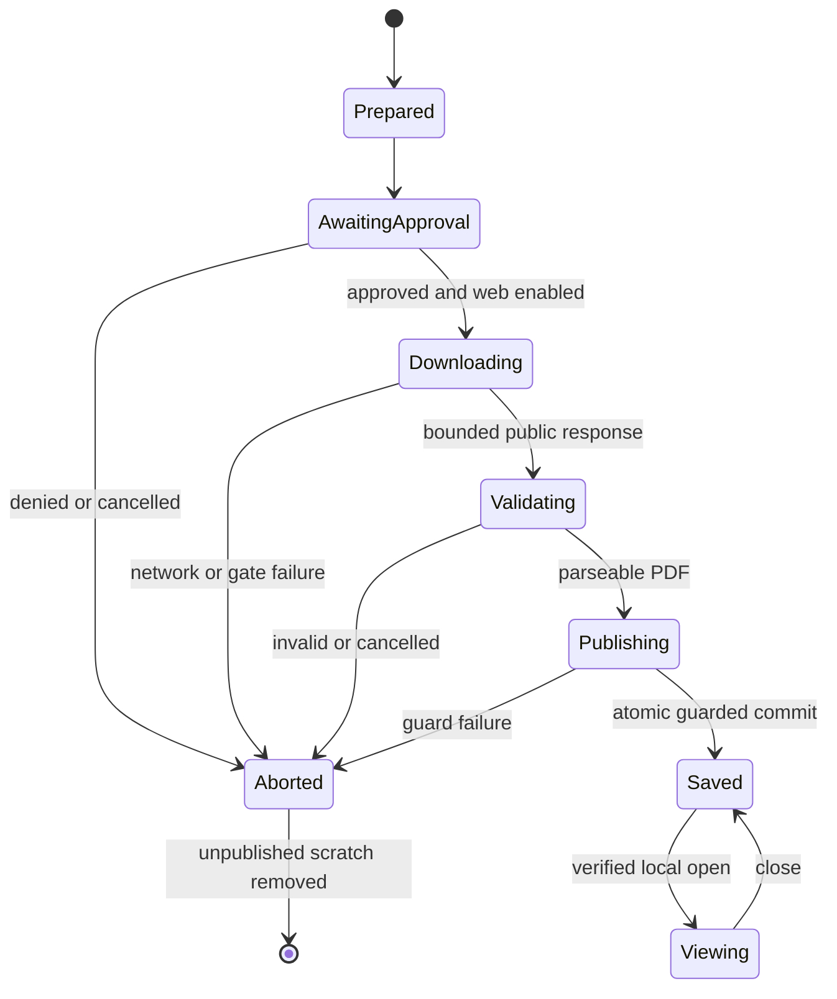

# TASK-6bbaec5c diagrams

Illustrates `## Design` in `TASK-6bbaec5c.md`. The Design text is authoritative.

## Structure

Node map: web_download/PdfDownloads/pdf-transfer/Downloads UI added; ApprovalGate (payload), ConfiguredWebProvider, IPC and ViewerContext changed; PdfExtractor/PDFViewer reused unchanged.

## Sequence

## State

