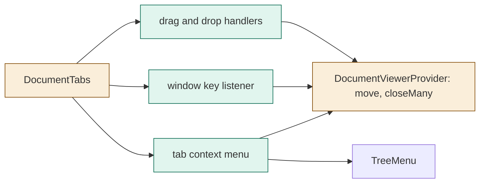

# TASK-6c4aeed8 diagrams

Illustrates `## Design` in `TASK-6c4aeed8.md`. The Design text is authoritative.

| Node | Class |
|---|---|
| tab context menu use, window key listener, drag handlers | added |
| DocumentTabs, DocumentViewerProvider (move, closeMany) | changed |
| TreeMenu | unchanged (reused) |

## Structure

## Sequence

Not drawn: every flow stays inside the renderer's tab component and provider, with no process boundary or asynchronous work.

## State

Not drawn: the tab lifecycle of TASK-79f6ffd3 is unchanged; moves only reorder the set.
