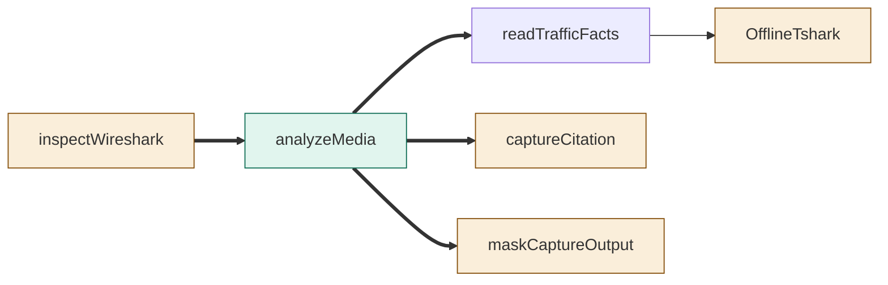
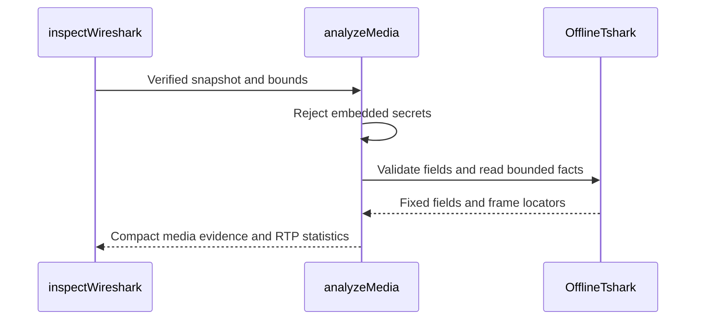

# TASK-6c9ed425 diagrams

Illustrates the Design in [TASK-6c9ed425.md](TASK-6c9ed425.md).

## Structure

Media projection is added. The service, native validation, citation and model projection change. The traffic facts reader is reused.

## Sequence

## State

Not drawn: the operation adds no lifecycle.
