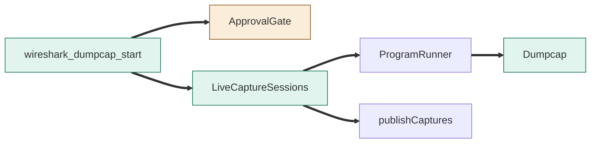
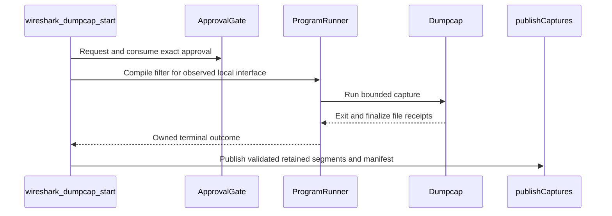
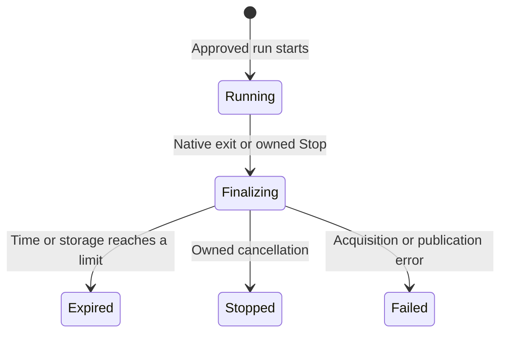

# TASK-6ca805fc diagrams

The journal's Design is authoritative.

## Structure

New nodes are `wireshark_dumpcap_start`, `Dumpcap` and `LiveCaptureSessions`. `ApprovalGate` changes. `ProgramRunner` and `publishCaptures` are reused.

## Sequence

## State

