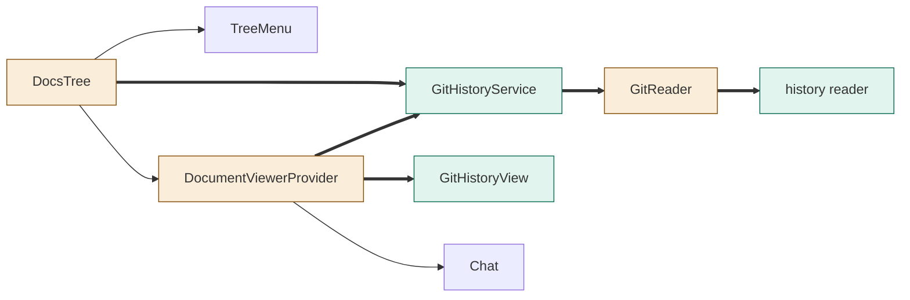
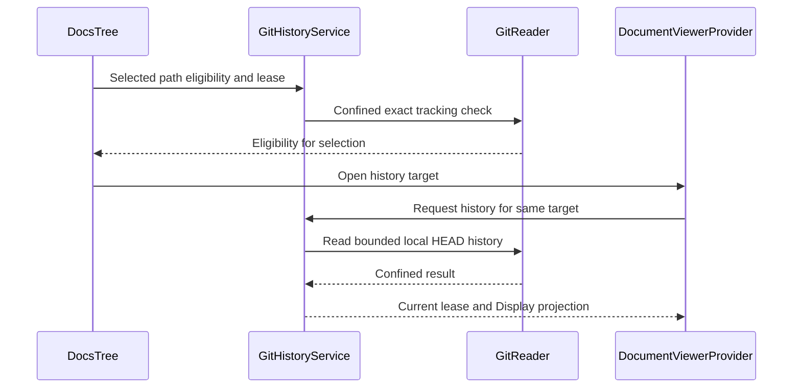
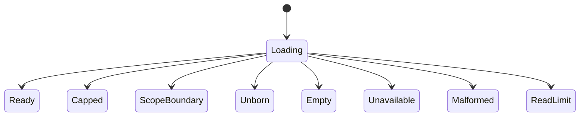

# TASK-70a10e42 diagrams

Illustrates the Design in [TASK-70a10e42.md](TASK-70a10e42.md).

## Structure

Changed: DocsTree, GitReader, DocumentViewerProvider. Added: GitHistoryService, history reader and GitHistoryView. Reused: TreeMenu and Chat.

## Sequence

## State

