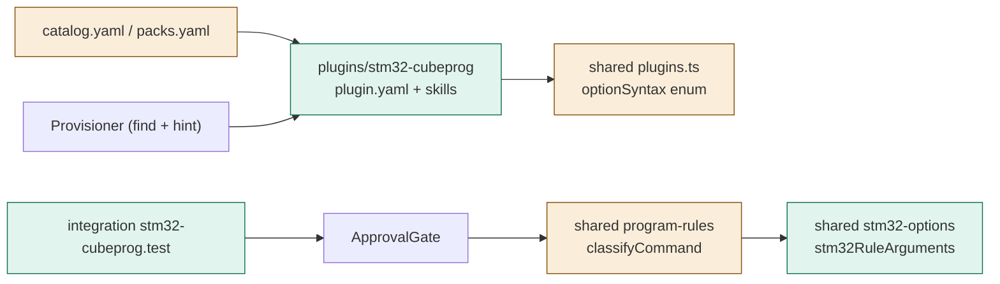

# TASK-71300a15 diagrams

Illustrates `## Design` in `TASK-71300a15.md`. The Design text is authoritative.

Node map: added = stm32-cubeprog package, stm32-options projection, fixtures, test; changed = plugins.ts enum,
classifyCommand dispatch, catalog/packs; unchanged = Provisioner, ApprovalGate, ProgramRunner.

## Structure

## Sequence

Not drawn: the existing run_program path (classify, gate, runner).

## State

Not drawn: no new lifecycle.
