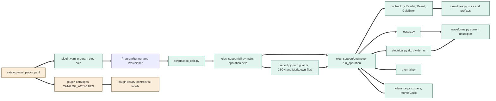
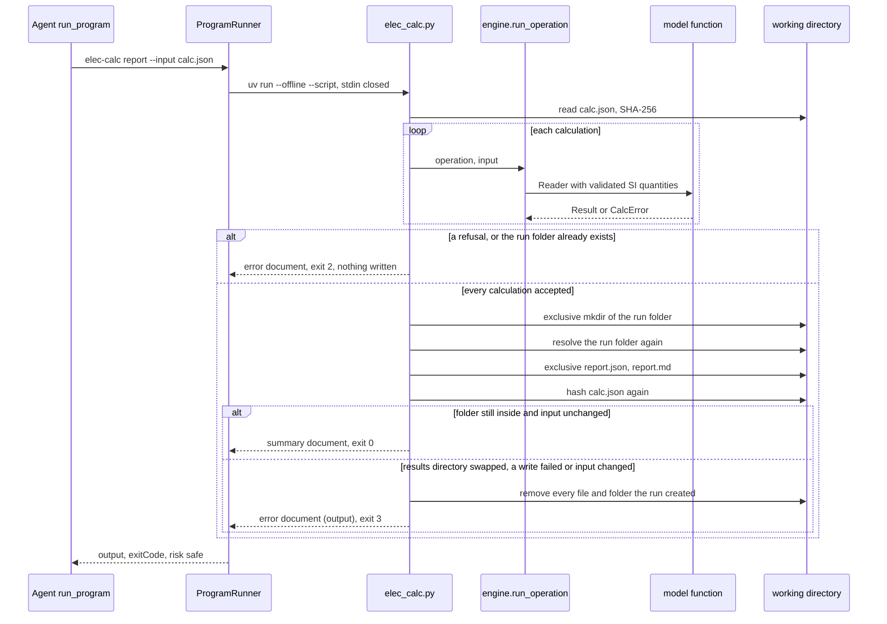

# TASK-72227ab6 diagrams

Illustrates `## Design` in `TASK-72227ab6.md`. The Design text is authoritative.

Node map: added - `elec_calc.py`, `cli.py`, `engine.py`, `contract.py`, `quantities.py`, `waveforms.py`,
`electrical.py`, `losses.py`, `thermal.py`, `tolerance.py`, `report.py`, `plugin.yaml`; changed -
`catalog.yaml` and `packs.yaml`, `plugin-catalog.ts`, `plugin-library-controls.tsx`; unchanged - the
program runner and provisioner.

## Structure

## Sequence

## State

Not drawn: the design adds no lifecycle; a result's `status` is decided once per run.
