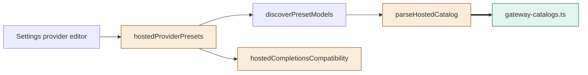
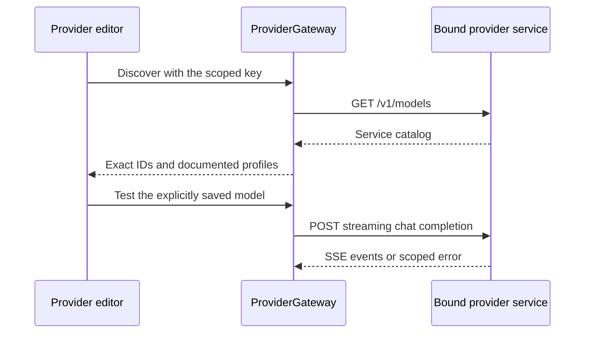

# TASK-7227c48f diagrams

Illustrates the Design in `TASK-7227c48f.md`.

## Structure

Changed: hostedProviderPresets, parseHostedCatalog, hostedCompletionsCompatibility.
Added: gateway-catalogs.ts. Reused: picker and preset discovery.

## Sequence

## State

No lifecycle or persisted state transition changes.
