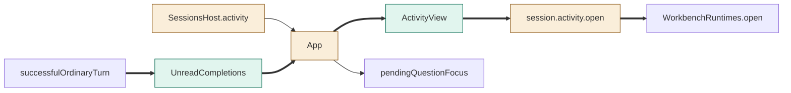
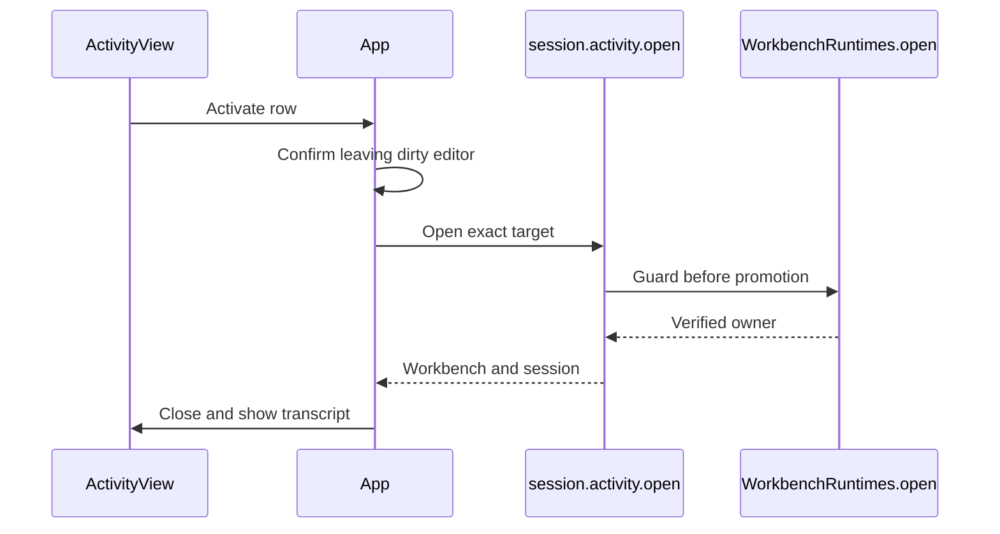
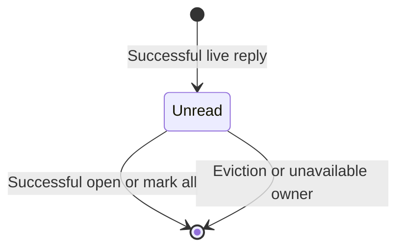

# TASK-760b7ec0 diagrams

Illustrates the Design in TASK-760b7ec0.md.

## Structure

Added: UnreadCompletions, ActivityView. Changed: App, SessionsHost, sessionActivityOpen.
Reused: successfulOrdinaryTurn, WorkbenchRuntimes.open, pendingQuestionFocus.

## Sequence

## State

