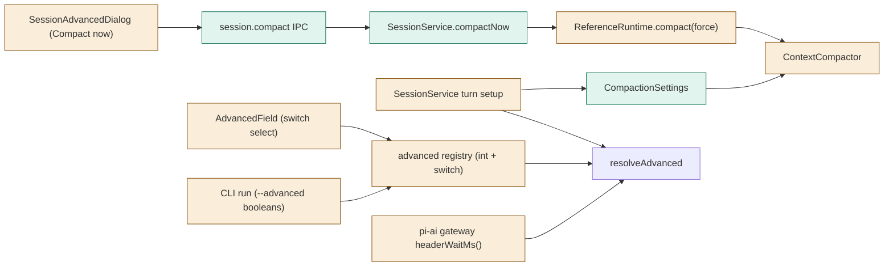
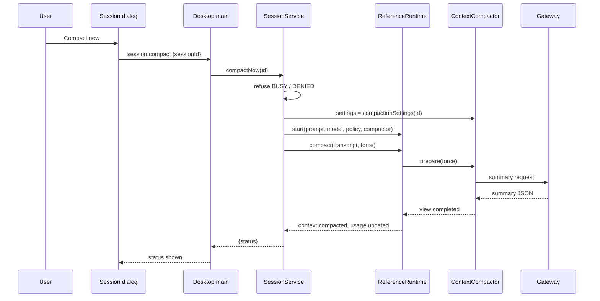
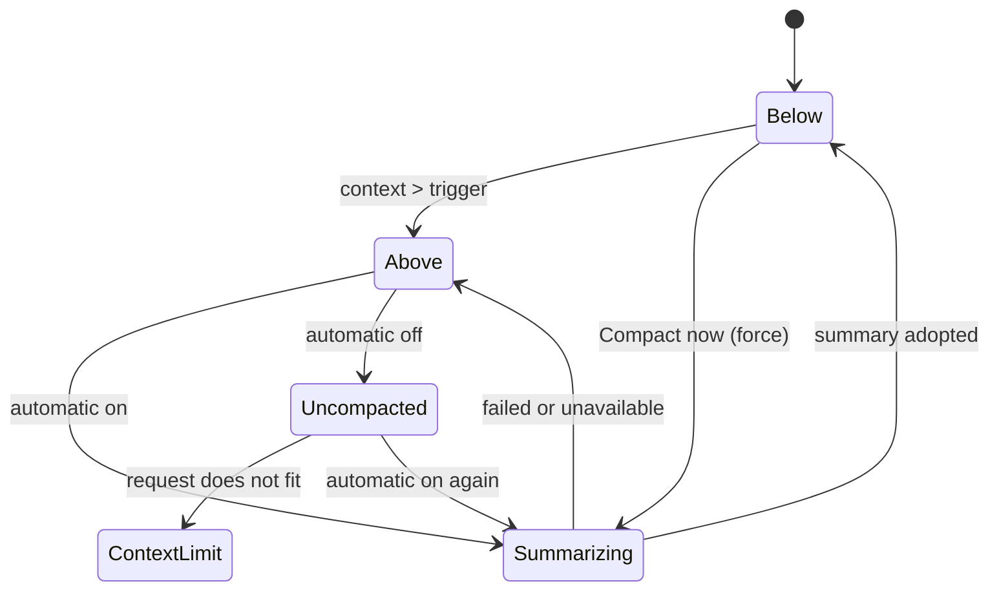

# TASK-76ca8aa6 diagrams

Illustrates `## Design` in `TASK-76ca8aa6.md`. The Design text is authoritative.

Node classes: added = session.compact IPC, SessionService.compactNow, CompactionSettings; changed = advanced registry, ContextCompactor, ReferenceRuntime.compact, SessionService turn setup, pi-ai gateway, AdvancedField, SessionAdvancedDialog, CLI run.

## Structure

## Sequence

## State

