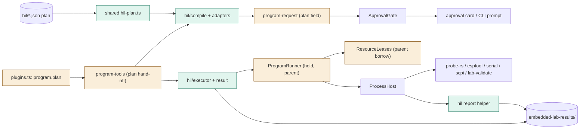
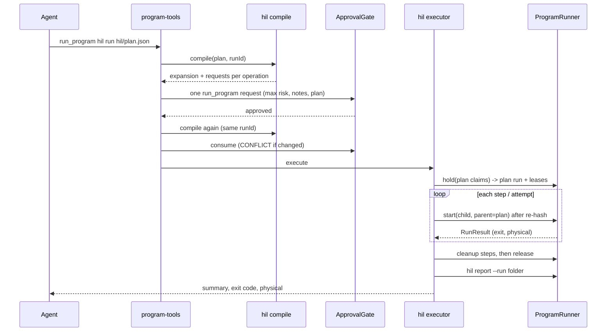
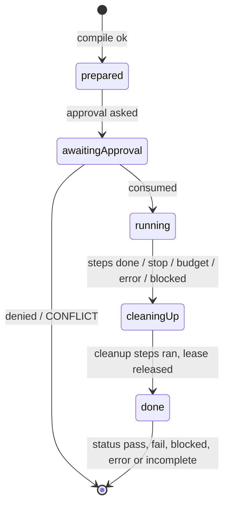

# TASK-789dcc82 diagrams

Illustrates `## Design` in `TASK-789dcc82.md`. The Design text is authoritative.

Node classes: added - shared hil-plan schema, core hil compile/adapters/executor/result, hil-testing package (helper
report, skill); changed - plugin manifest schema (program.plan), program-tools (plan hand-off), program-request (plan
field), ProgramRunner (hold, parent), ResourceLeases (parent borrow); unchanged - ApprovalGate, approval card / CLI
prompt, probe-rs, serial-monitor, scpi-instruments and lab-validation plugins, ProcessHost.

## Structure

## Sequence

## State

