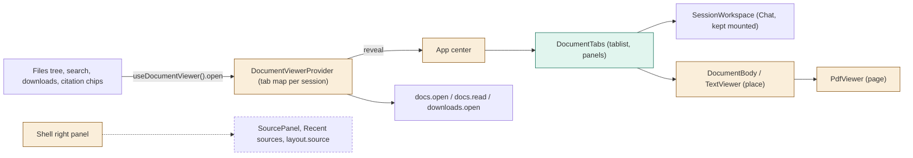
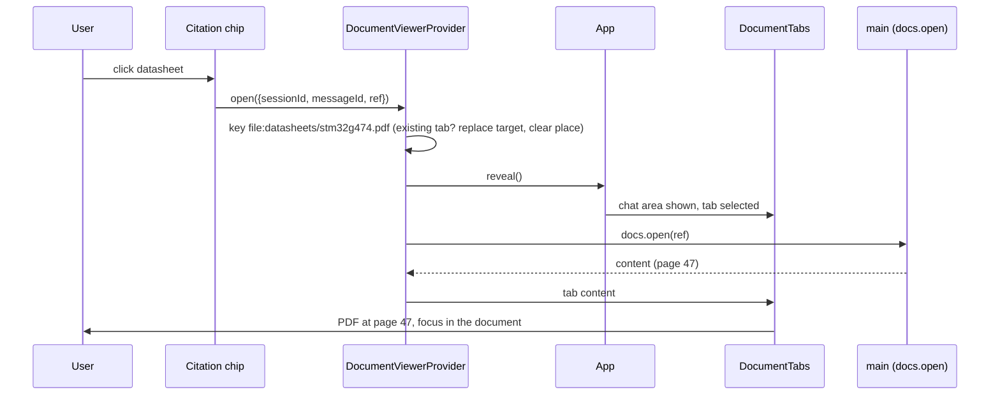
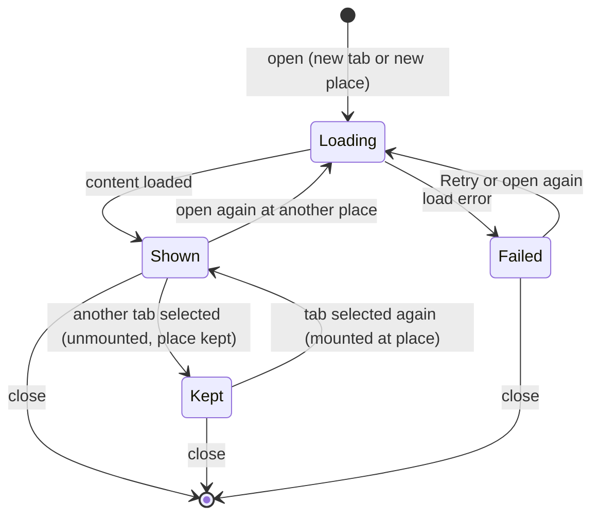

# TASK-79f6ffd3 diagrams

Illustrates `## Design` in `TASK-79f6ffd3.md`. The Design text is authoritative.

| Node | Class |
|---|---|
| DocumentTabs | added |
| DocumentViewerProvider, DocumentBody/TextViewer, PdfViewer, App center, Shell right panel, layout.ts | changed |
| SourcePanel, Source tab, Recent sources, layout.source | removed |
| Files tree / search / downloads / transcript openers, docs.open / docs.read / downloads.open | unchanged (reused) |

## Structure

## Sequence

## State

