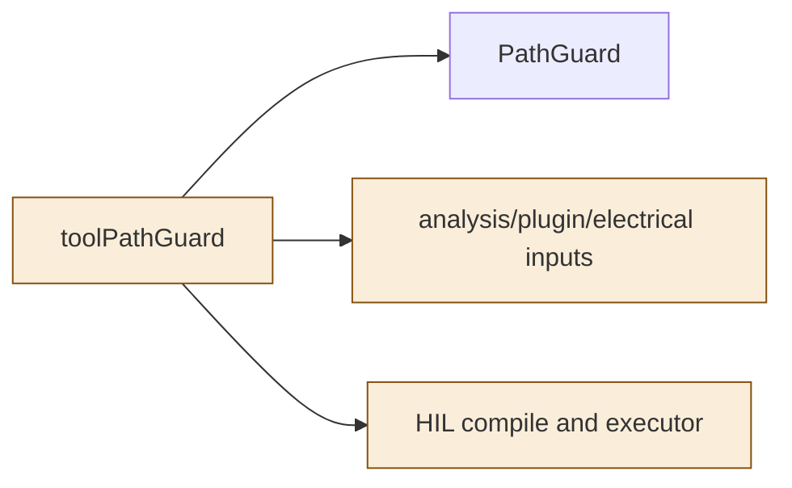
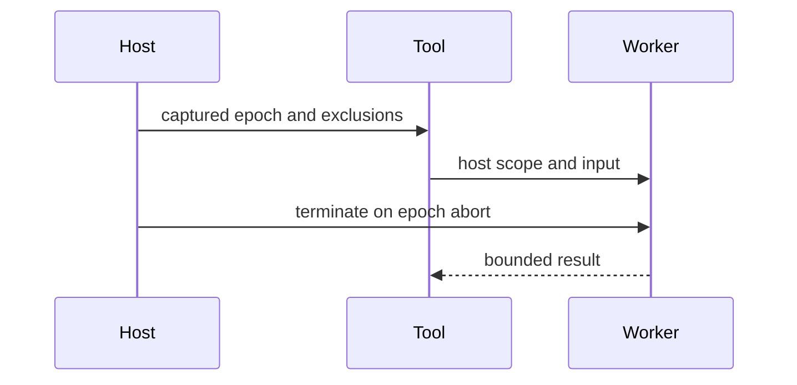

# TASK-7b920e3b diagrams

Illustrates Design in TASK-7b920e3b.md. Design is authoritative.

## Structure

Map: context, input helpers and HIL executor changed; PathGuard reused unchanged.

## Sequence

## State

Not drawn: permission states and transitions are unchanged.
