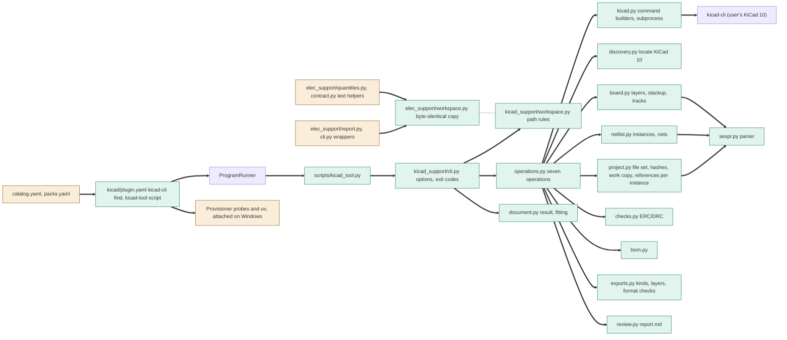
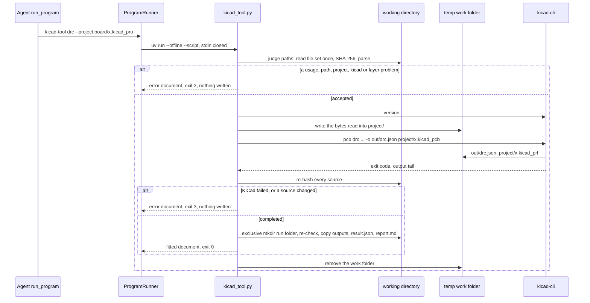
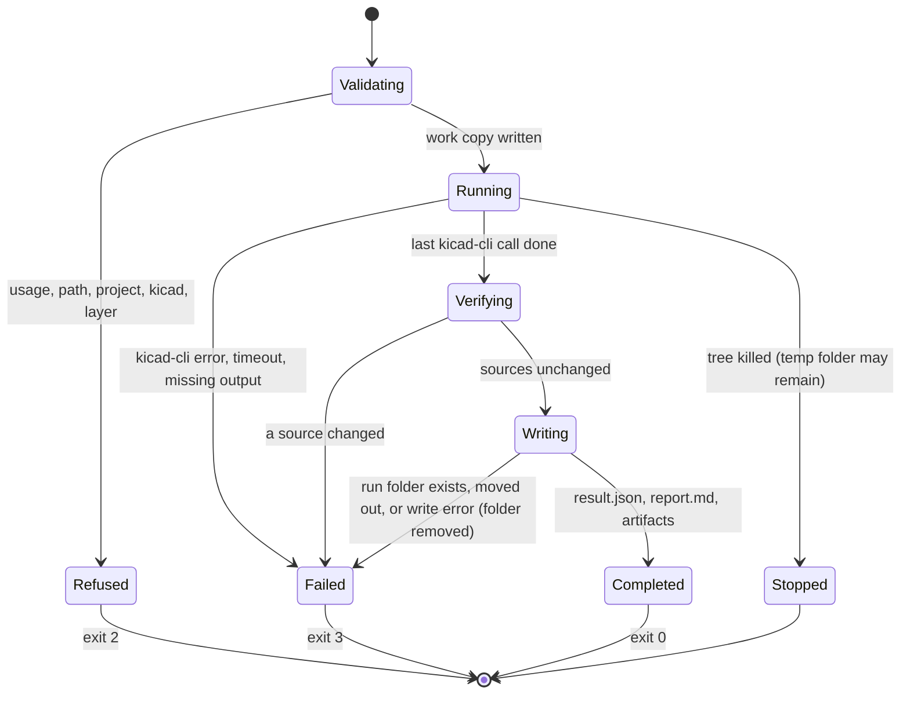

# TASK-7c2a9322 diagrams

Illustrates `## Design` in `TASK-7c2a9322.md`. The Design text is authoritative.

Node map: added - `plugin.yaml` (kicad), `kicad_tool.py`, `kicad_support/cli.py`, `operations.py`, `project.py`,
`sexpr.py`, `discovery.py`, `kicad.py`, `netlist.py`, `board.py`, `checks.py`, `bom.py`, `exports.py`,
`review.py`, `document.py`, `kicad_support/workspace.py`, `elec_support/workspace.py`; changed -
`elec_support/report.py`, `cli.py`, `quantities.py` and `contract.py` (path rules and text helpers moved out), `catalog.yaml` and `packs.yaml`, the provisioner (probes and uv
calls without a process group on Windows); unchanged - the program runner and kicad-cli.

## Structure

## Sequence

## State

