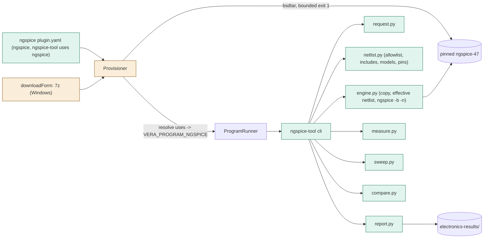
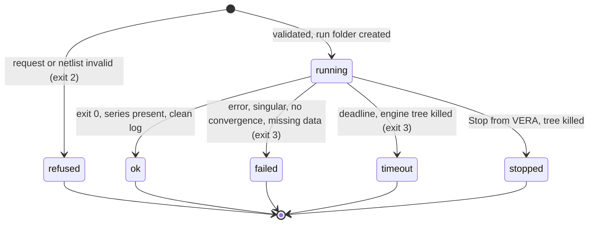

# TASK-80043c39 diagrams

Illustrates `## Design` in `TASK-80043c39.md`. The Design text is authoritative.

Node classes: added - ngspice plugin manifest, ngspice-tool (cli, request, netlist, engine, measure, sweep, compare,
report), the 7z form, the uses resolution; changed - downloadForm, provisioner extraction and resolve; unchanged -
ProgramRunner, program tools, ngspice engine.

## Structure



## Sequence

```mermaid
sequenceDiagram
    participant Agent
    participant Runner as ProgramRunner
    participant Tool as ngspice-tool
    participant Engine as ngspice
    Agent->>Runner: run_program ngspice-tool run --input req.json
    Runner->>Tool: start (env VERA_PROGRAM_NGSPICE)
    Tool->>Tool: read request, parse netlist chain, refuse before the engine
    Tool->>Tool: copy chain to run folder, effective.cir with control block
    Tool->>Engine: ngspice -b -n effective.cir (cwd run folder, deadline)
    Engine-->>Tool: exit, ngspice.log, series.dat
    Tool->>Tool: classify log, parse series, measure, criteria
    Tool-->>Runner: summary (result.json, report.md, series.csv, plot.svg)
    Runner-->>Agent: output; Stop kills the tree
```

## State


