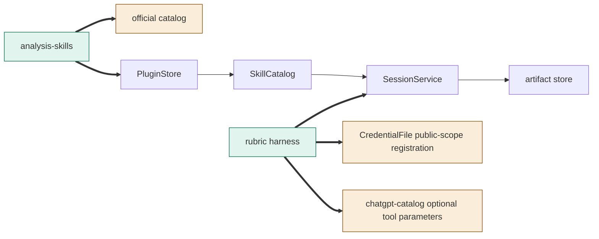
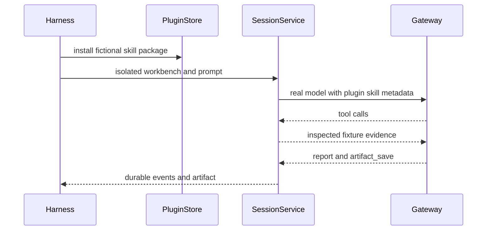

# TASK-86a7c2d9 diagrams

Illustrates Design in TASK-86a7c2d9.md; Design is authoritative.

## Structure

Map: analysis-skills added; official catalog changed; rubric harness added; CredentialFile and chatgpt-catalog changed by the two immediate-consumer repairs; PluginStore, SkillCatalog, SessionService and artifact store reused unchanged.

## Sequence

## State

Not drawn: no product lifecycle or state transition changes.
