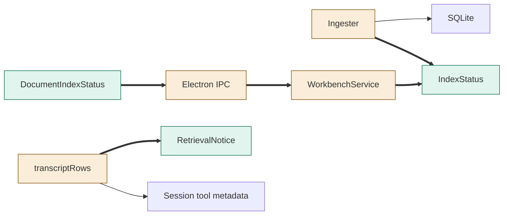
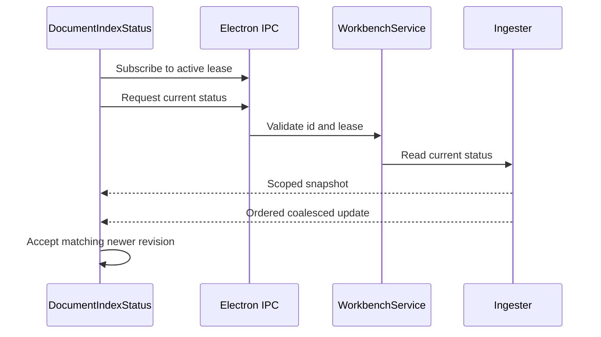
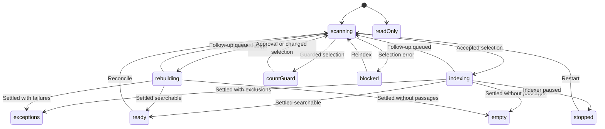

# TASK-893d6290 diagrams

The [journal design](TASK-893d6290.md) defines the implementation.

## Structure

Added: IndexStatus, DocumentIndexStatus, RetrievalNotice. Changed: Ingester,
WorkbenchService, Electron IPC, transcriptRows. Reused: SQLite, session tool metadata.

## Sequence

## State

