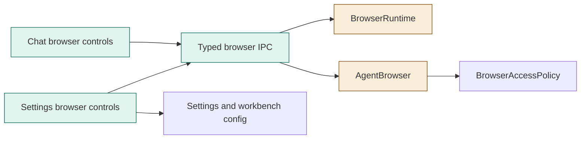
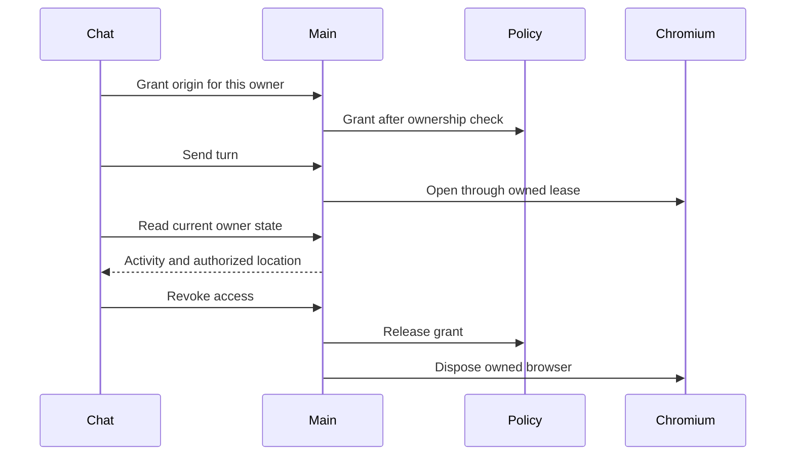
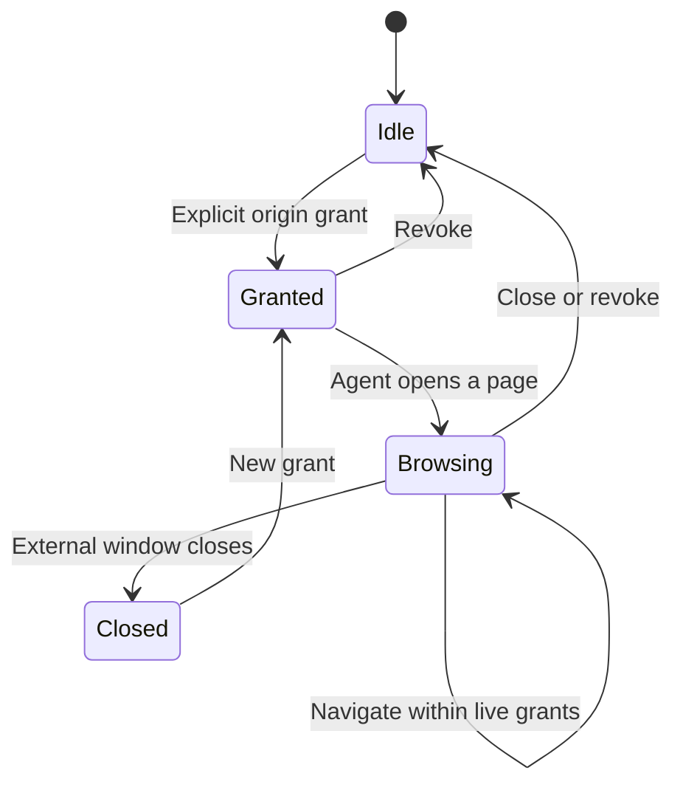

# TASK-8983b2e8 diagrams

Illustrates the design in [TASK-8983b2e8.md](TASK-8983b2e8.md).

## Structure

Added: Settings and Chat browser controls, typed IPC. Changed: BrowserRuntime, AgentBrowser.
Reused: BrowserAccessPolicy, workbench config, app settings.

## Sequence

## State

