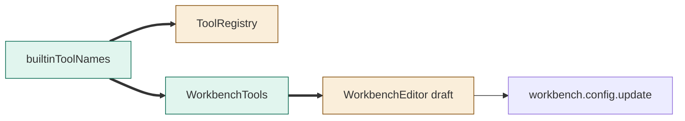

# TASK-8befc086 diagrams

Illustrates Design in TASK-8befc086.md. Design text is authoritative.

## Structure

Node map: builtinToolNames added; ToolRegistry changed; WorkbenchTools added; WorkbenchEditor changed; configuration API reused unchanged.

## Sequence

Not drawn: the save IPC flow is unchanged.

## State

Not drawn: existing editor draft/save lifecycle is unchanged.
