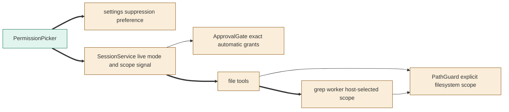
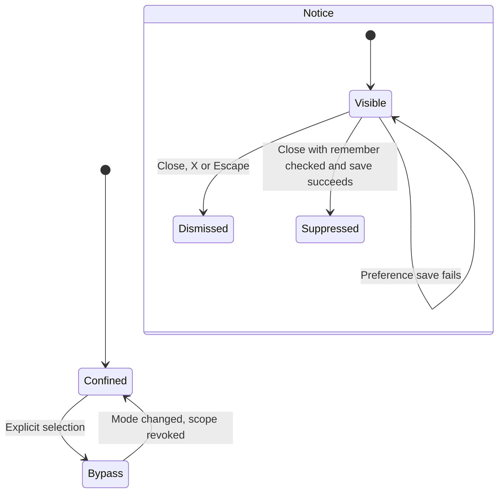

# TASK-8f446150 diagrams

Illustrates Design in TASK-8f446150.md; the Design text is authoritative.

## Structure

Node map: PermissionPicker added; settings/shared mode, SessionService, ApprovalGate, PathGuard and grep worker changed; existing file tools changed to receive host-selected scope.



## Sequence

```mermaid
sequenceDiagram
  participant User
  participant Picker as PermissionPicker
  participant Session as SessionService
  participant Tools as File tools
  participant FS as Operating system
  User->>Picker: Select marked Bypass
  Picker->>Session: Persist bypass mode
  Picker->>User: Show dismissible risk notice
  Session->>Tools: Live mode and revocable filesystem scope
  Tools->>FS: Ordinary file I/O inside or outside workbench
  User->>Picker: Select another mode
  Picker->>Session: Persist mode and revoke scope signal
  Session->>Tools: Abort scoped work; later paths confined
```

## State


