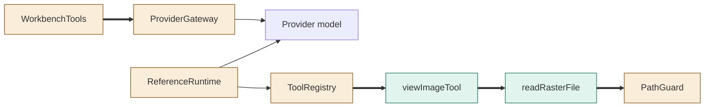
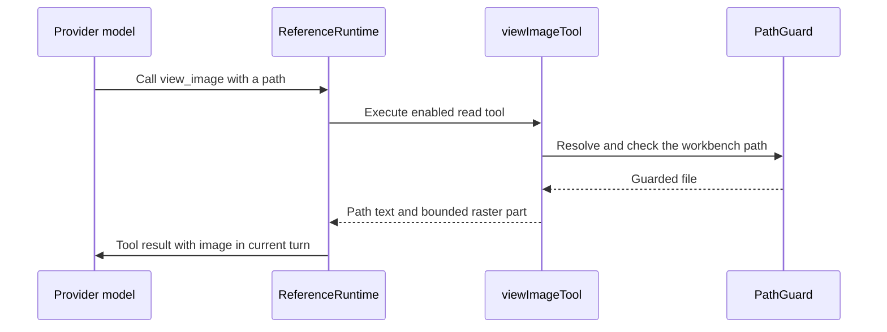

# TASK-9091aa22 diagrams

Illustrates the Design in TASK-9091aa22.md.

## Structure

Added: viewImageTool, readRasterFile. Changed: WorkbenchTools, ProviderGateway, ReferenceRuntime, ToolRegistry, PathGuard. Reused: provider model.

## Sequence

## State

Not drawn: The design uses the existing turn lifecycle.
