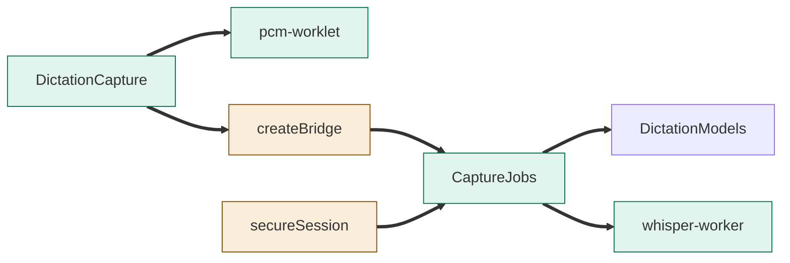
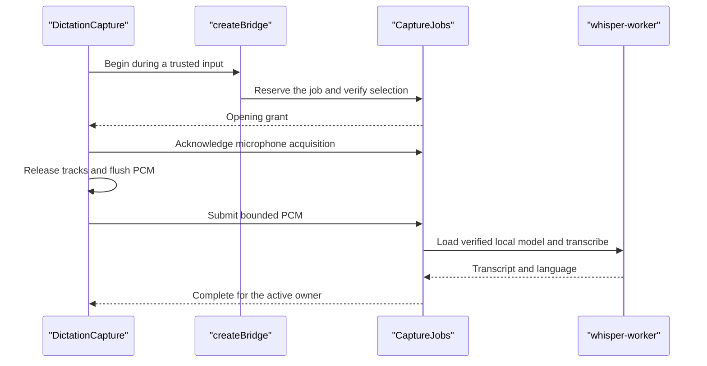
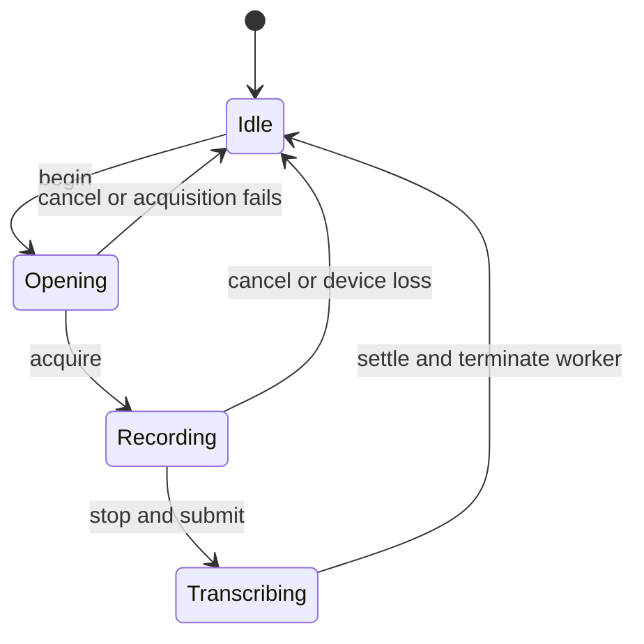

# TASK-91f2fb57 diagrams

Illustrates the design in [TASK-91f2fb57](TASK-91f2fb57.md).

## Structure

Added: DictationCapture, pcm-worklet, CaptureJobs, whisper-worker. Changed: createBridge, secureSession. Reused: DictationModels.

## Sequence

## State

