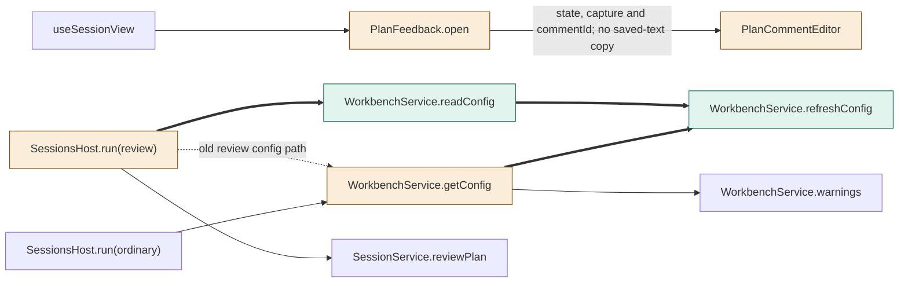
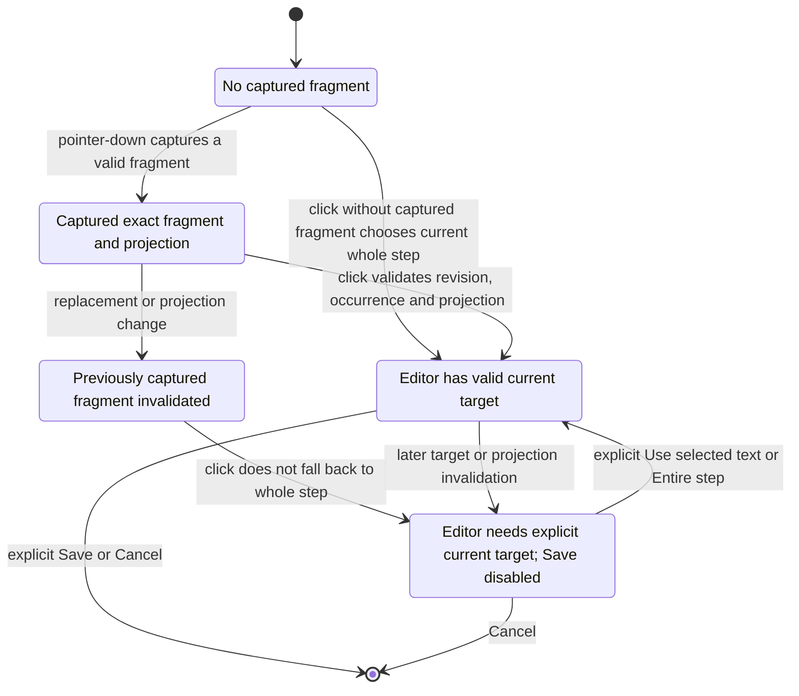

# TASK-949579dc diagrams

Illustrates `## Design` in [TASK-949579dc.md](TASK-949579dc.md). The Design text is authoritative.
INFERRED: these diagrams describe proposed R1-R3 implementation, not executed proof.

## Structure

Node classification from the explicit Design edits:

- Changed: `PlanFeedback.open` (saved-content context and pointer-capture handling),
  `PlanCommentEditor` (live saved text versus user draft), `SessionsHost.run(review)`
  (warning-free config routing), `WorkbenchService.getConfig` (shared refresh helper).
- Added: `WorkbenchService.readConfig`, `WorkbenchService.refreshConfig` methods in the
  existing service file; no new production module.
- Unchanged: `useSessionView`, `SessionsHost.run(ordinary)` preparation behavior,
  `WorkbenchService.warnings`, `SessionService.reviewPlan` admission/runtime boundary.
- Removed nodes: none. Only the review-purpose getConfig call edge is removed;
  ordinary configuration callers keep it and its warnings.
- Unchanged edges retain their calls/data flow; new edges add readConfig/helper calls.



## Sequence

R3 keeps config/pinned reads inside existing lifecycle queues and checks captured scope
between awaits. The sequence shows the successful review-preparation path and its existing
scope-failure boundary; ordinary getConfig still computes warnings separately.

```mermaid
sequenceDiagram
    participant Caller as "planReviewHandlers"
    participant Host as "SessionsHost.run(review)"
    participant WB as "WorkbenchService"
    participant Files as "FilePort"
    participant Core as "SessionService.reviewPlan"
    Caller->>Host: Captured workbench and DB scope
    Host->>Host: Assert captured scope in serial queue
    Host->>WB: readConfig()
    WB->>WB: Queue once, refreshConfig()
    WB->>Files: Read current confined workbench.yaml
    Files-->>WB: Current file contents
    WB->>WB: Parse, validate identity, refresh state
    Note over WB: No warnings(), skill discovery or plugin discovery
    WB-->>Host: WorkbenchConfig
    Host->>Host: Recheck workbench and DB scope
    Host->>WB: getPinned()
    WB->>Files: Read current confined WORKBENCH.md
    Files-->>WB: Pinned context
    WB-->>Host: Pinned result
    alt Captured scope still current
        Host->>Host: Recheck scope, prepare restricted prompt
        Host->>Core: Existing review admission
        Core-->>Caller: Existing durable review receipt
    else Workbench or DB replaced
        Host-->>Caller: Existing CONFLICT; no replacement effect
    end
```

## State

R2's states describe capture validity, not new persisted status fields. A no-fragment click
keeps existing whole-step behavior; an invalidated previously valid fragment is a distinct path.
The pointer ref is consumed when opening. Existing authority/pending/save locks still apply.


