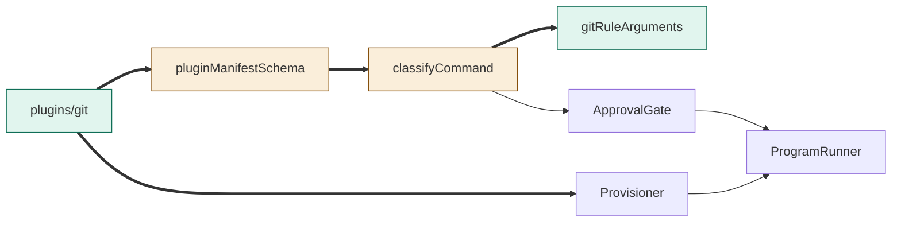
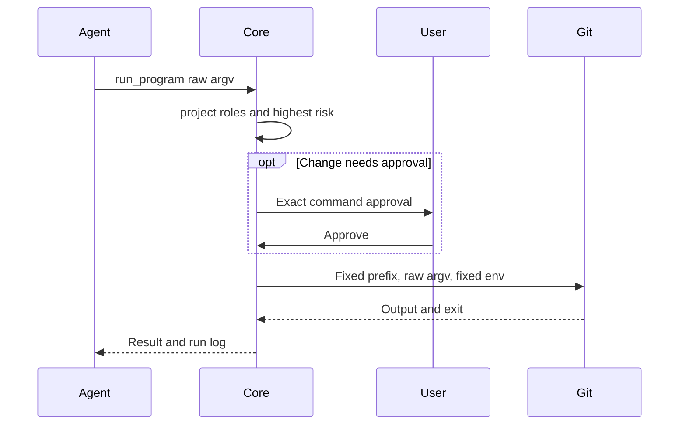

# TASK-951445ca diagrams

Illustrates the task Design. Map: Git package/projection added; manifest schema/classifyCommand changed; gate/provisioner/runner reused unchanged.

## Structure

## Sequence

## State
Not drawn: existing approval and runner states are reused unchanged.
