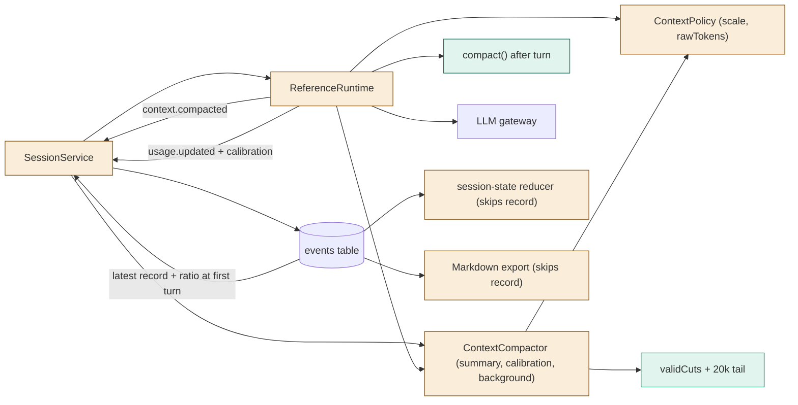
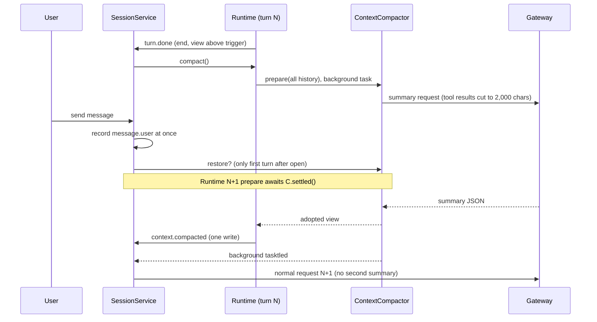
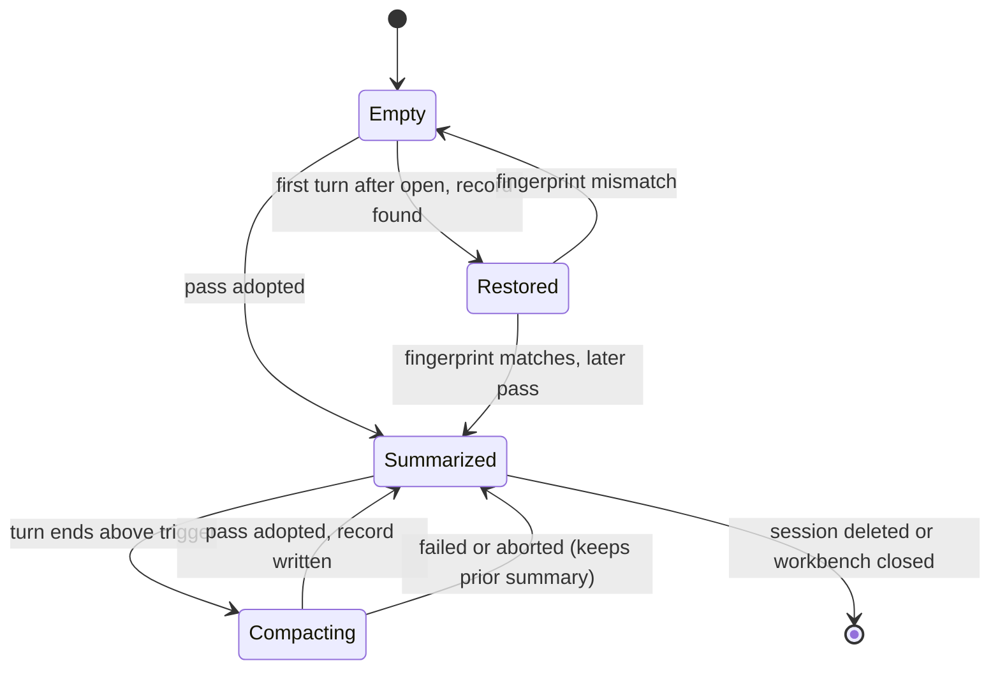

# TASK-95ab9d2a diagrams

Illustrates `## Design` in `TASK-95ab9d2a.md`. The Design text is authoritative.

Node classes: added = calibration usage field, context.compacted event, compact(), validCuts, background(); changed = ContextCompactor, ContextPolicy, ReferenceRuntime, SessionService, session-state reducer, Markdown export; unchanged = events table, gateway.

## Structure

## Sequence

## State

