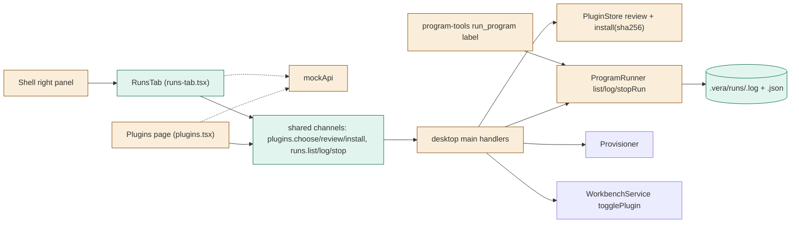
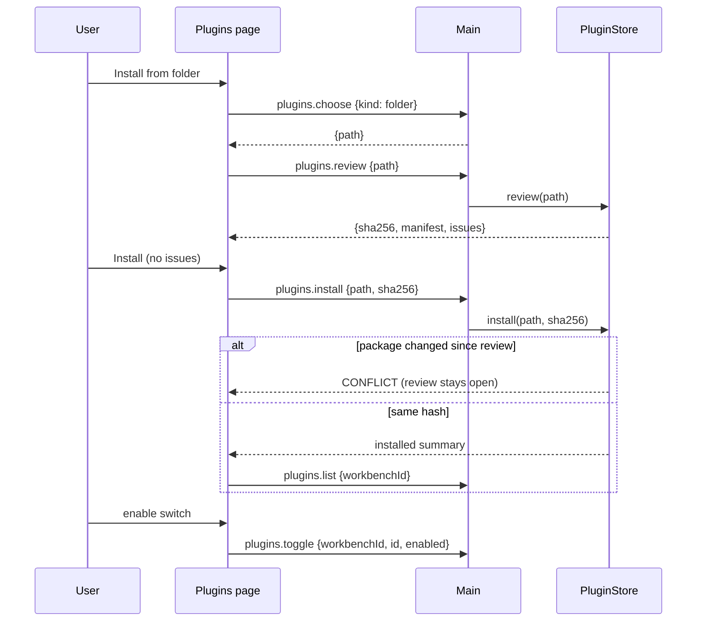
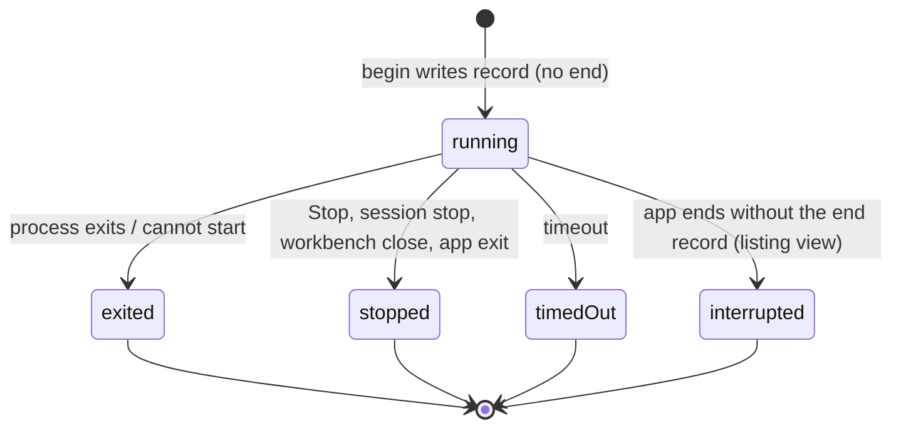

# TASK-98ecbd0a diagrams

Illustrates `## Design` in `TASK-98ecbd0a.md`. The Design text is authoritative.

Node map: added = plugins.choose, plugins.review, runs.* channels, RunsTab, run records; changed = Plugins page, PluginStore, ProgramRunner, program-tools, Shell, mockApi; unchanged = Provisioner, WorkbenchService.

## Structure

## Sequence

## State

