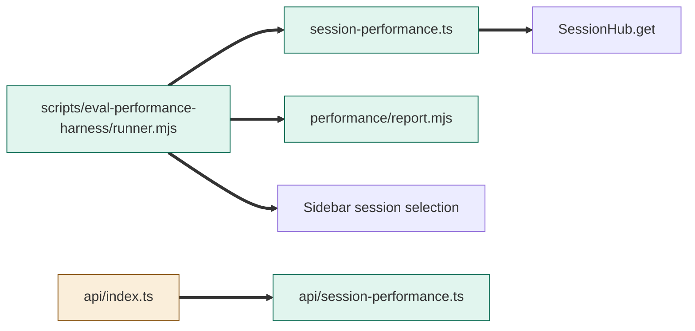
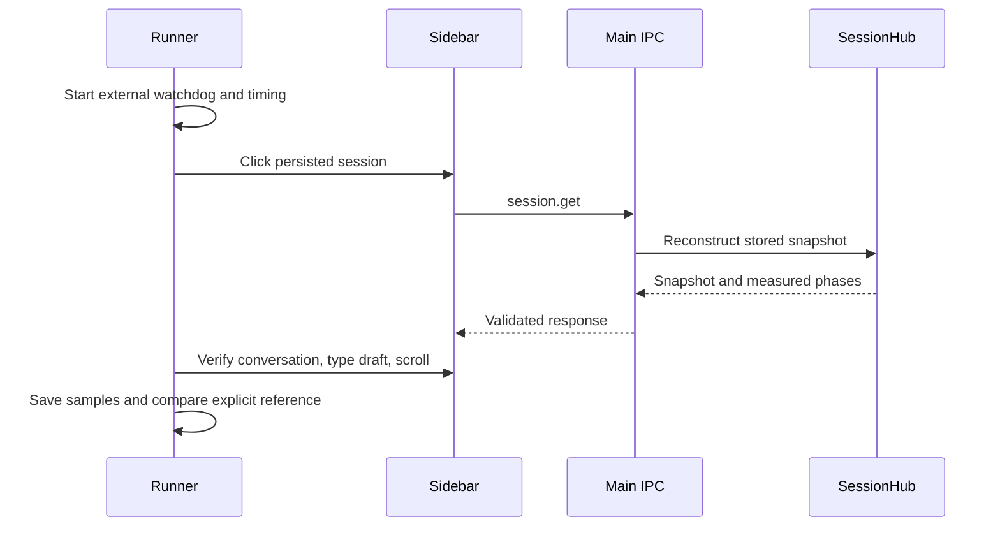
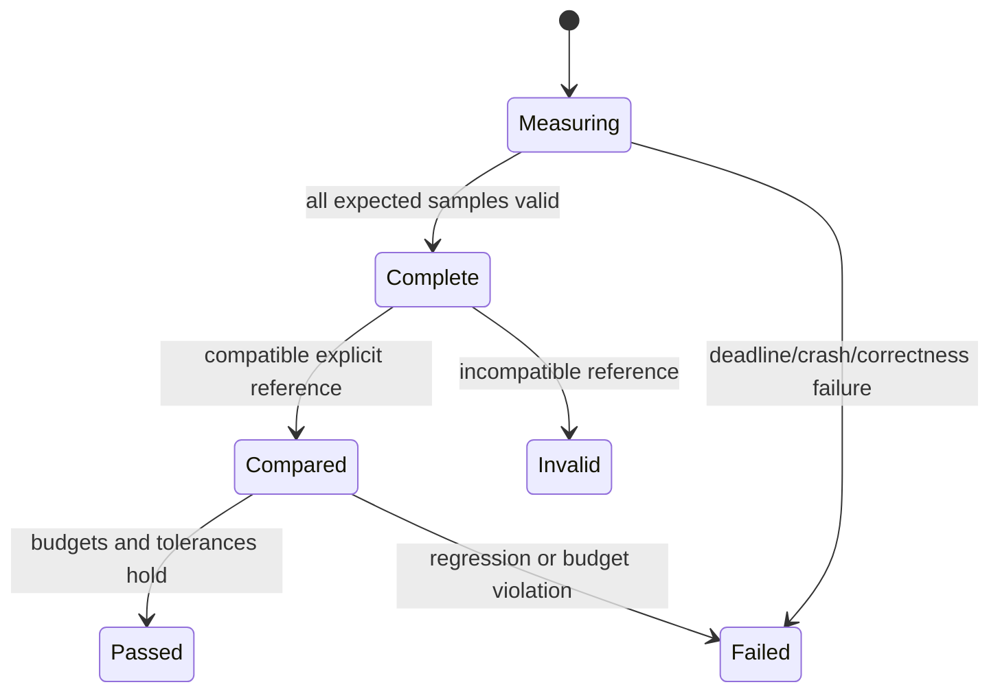

# TASK-9a4d3e8a diagrams

Design in TASK-9a4d3e8a.md is authoritative.
Node map: runner/report/probes added; build config and API/main composition changed; loader/IPC/UI reused unchanged.

## Structure

## Sequence

## State

