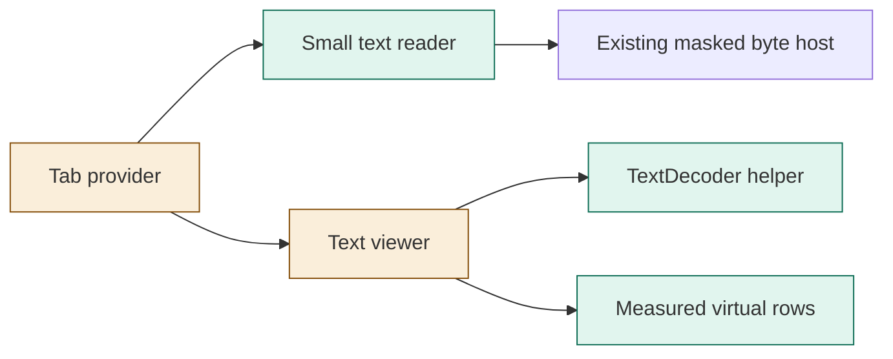
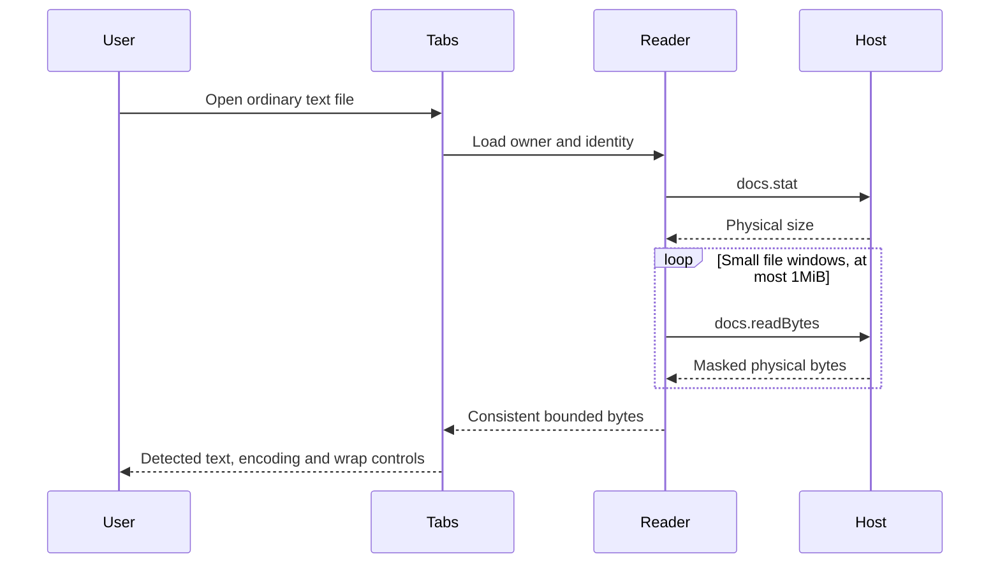
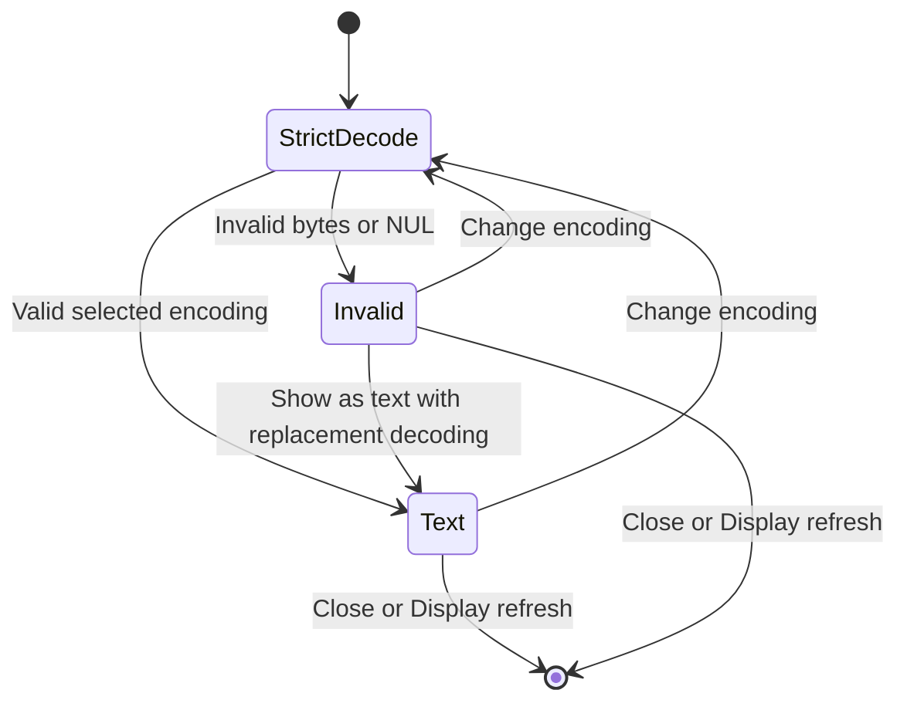

# TASK-9a5b9ff2 diagrams

Illustrates Design in TASK-9a5b9ff2.md; Design is authoritative.

## Structure

Node map: provider/text viewer changed; reader/decoder/row hook added; host reused unchanged.

## Sequence

## State

