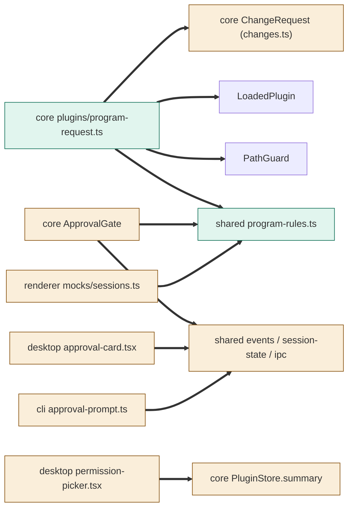
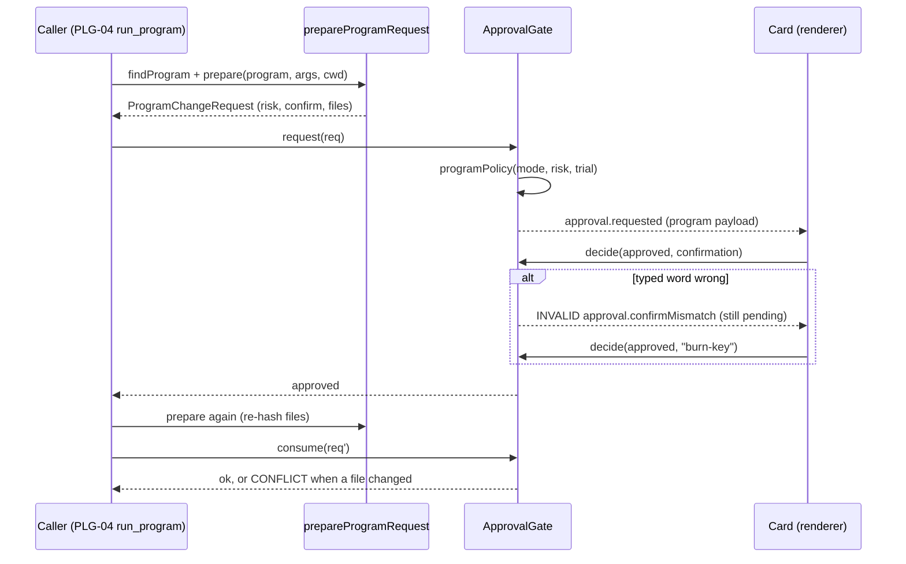
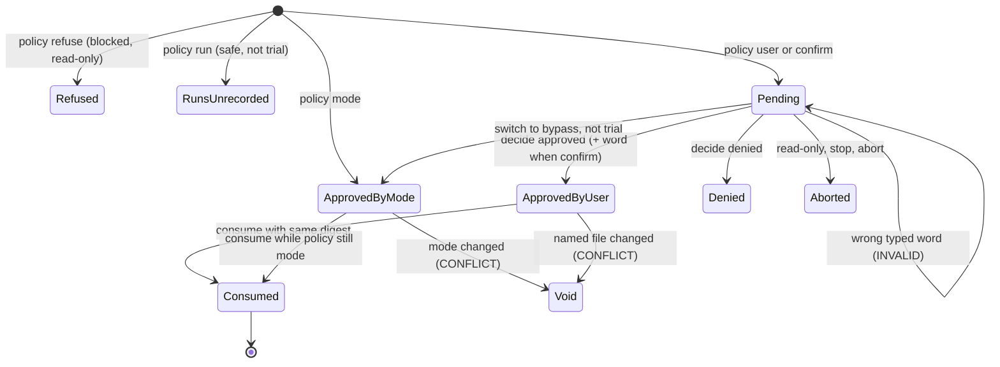

# TASK-9b39247f diagrams

Illustrates `## Design` in `TASK-9b39247f.md`. The Design text is authoritative.

Node classes: added = program-rules.ts, program-request.ts, program-approvals e2e; changed =
ApprovalGate, ChangeRequest (changes.ts), shared events/session-state/ipc, PluginStore, approval
card, permission picker, mock sessions, CLI approval prompt; unchanged = PathGuard, LoadedPlugin.

## Structure

## Sequence

## State

