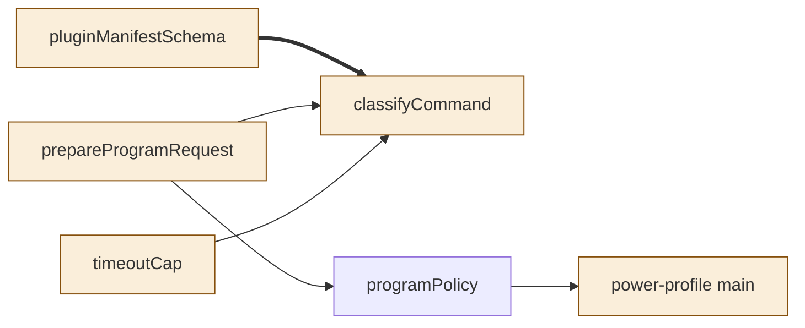
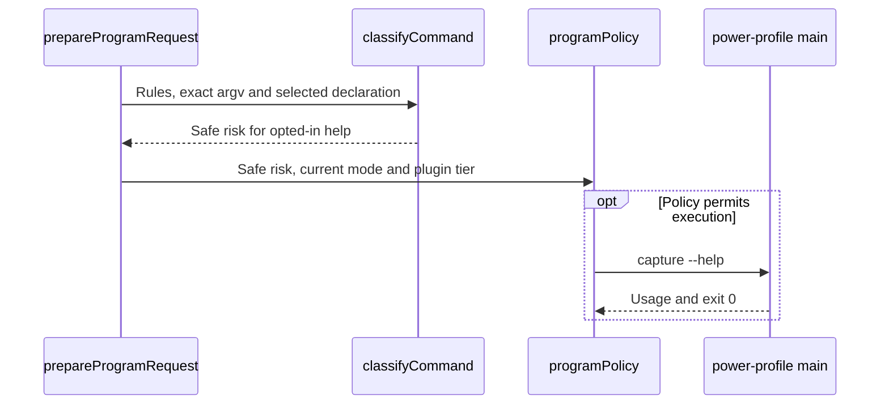

# TASK-9bf80989 diagrams

Illustrates the Design in `TASK-9bf80989.md`.

## Structure

Changed: pluginManifestSchema, classifyCommand, prepareProgramRequest, timeoutCap, power-profile main.
Unchanged: programPolicy.

## Sequence

## State

Not drawn because approval and trial state transitions stay as defined by existing policy.
