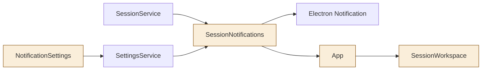
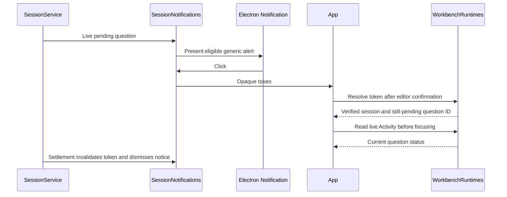
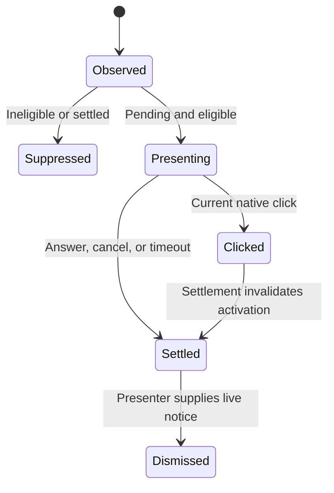

# TASK-9dd57a7c diagrams

Illustrates Design in TASK-9dd57a7c.md.

## Structure

Changed: SessionNotifications, NotificationSettings, App and SessionWorkspace.
Reused: SessionService, native presenter, settings service.

## Sequence

## State

