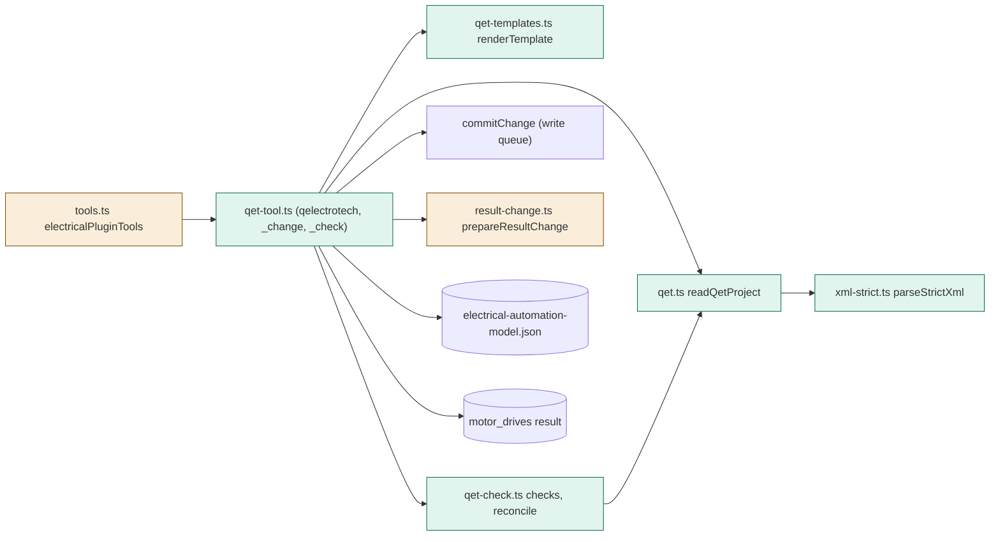
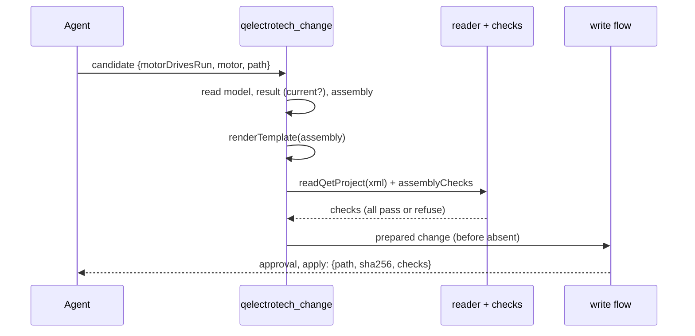

# TASK-9efaec3e diagrams

Illustrates `## Design` in `TASK-9efaec3e.md`. The Design text is authoritative.

Node map: added = xml-strict, qet, qet-templates, qet-check, qet-tool; changed = tools.ts gating, result-change;
unchanged = commitChange, model files, motor_drives results.

## Structure

## Sequence

## State

Not drawn: the change adds no lifecycle or status field; candidates are plain files and results keep the existing
current/stale freshness.
