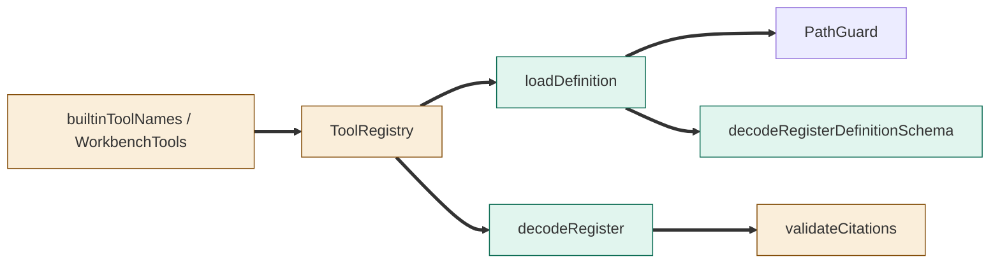
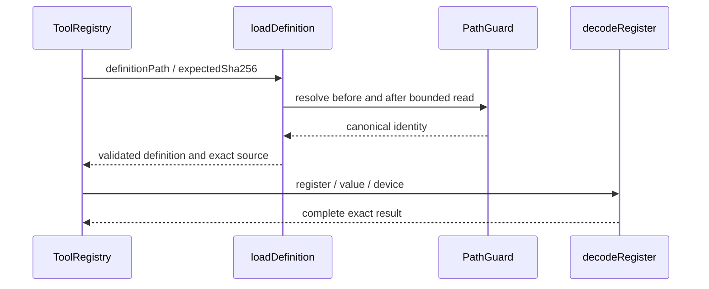

# TASK-a1c75648 diagrams

Illustrates Design in TASK-a1c75648.md. Node map: registry/catalog/citations changed; loader/decoder/contracts added; PathGuard reused unchanged.

## Structure

## Sequence

## State

Not drawn: this capability adds no lifecycle or persisted state.
