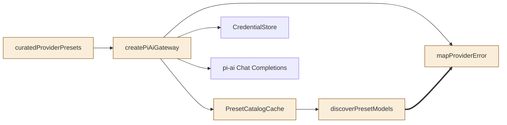
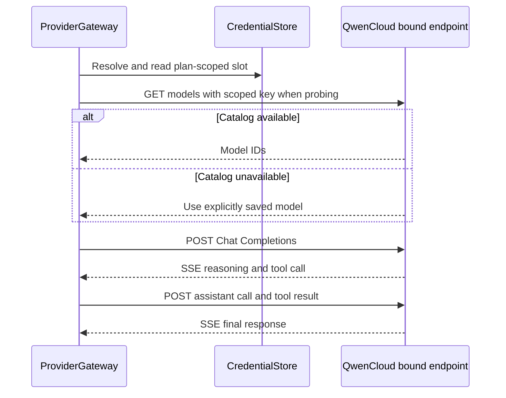

# TASK-a25cb06a diagrams

Illustrates the Design in TASK-a25cb06a.md.

## Structure

Changed: curatedProviderPresets, discoverPresetModels, createPiAiGateway, PresetCatalogCache and mapProviderError. Reused: CredentialStore and pi-ai Chat Completions.

## Sequence

## State

Not drawn: the task uses the existing gateway lifecycle and discovery statuses.
