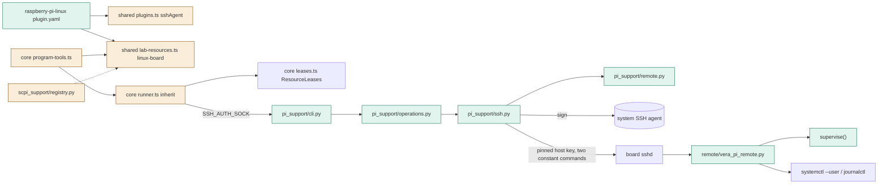
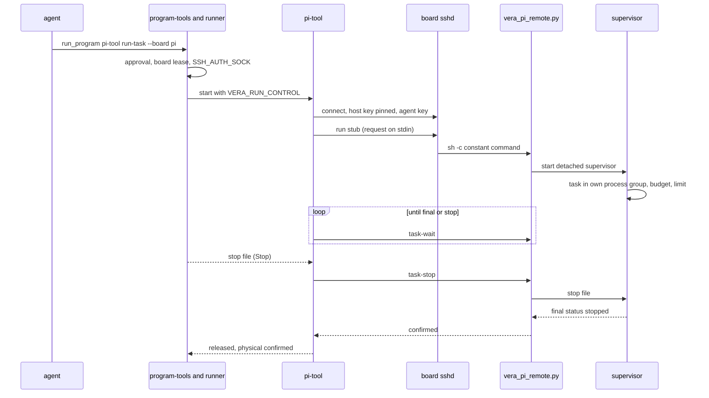
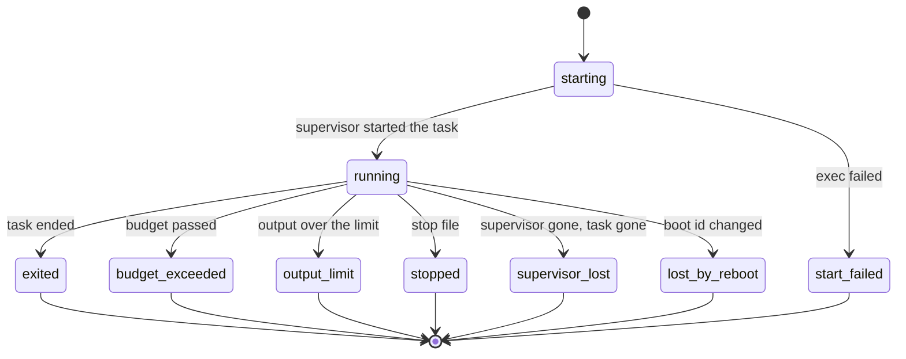

# TASK-a31dbad3 diagrams

Illustrates `## Design` in `TASK-a31dbad3.md`. The Design text is authoritative.

Node classes from the Design: added - raspberry-pi-linux plugin.yaml, pi-tool (cli, ssh, remote, operations), the
remote helper and its supervisor; changed - lab-resources.ts (kind linux-board), plugins.ts (sshAgent), program-tools.ts
(refusal and inherit), runner.ts (RunRequest.inherit), scpi registry.py (skips linux-board); unchanged - the lease
registry, the system SSH agent, sshd, systemd.

## Structure

## Sequence

## State

