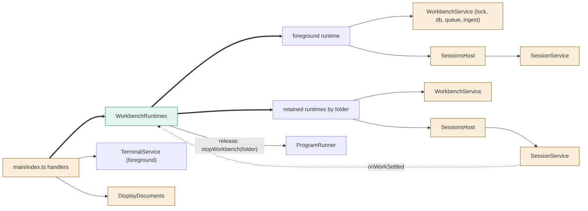
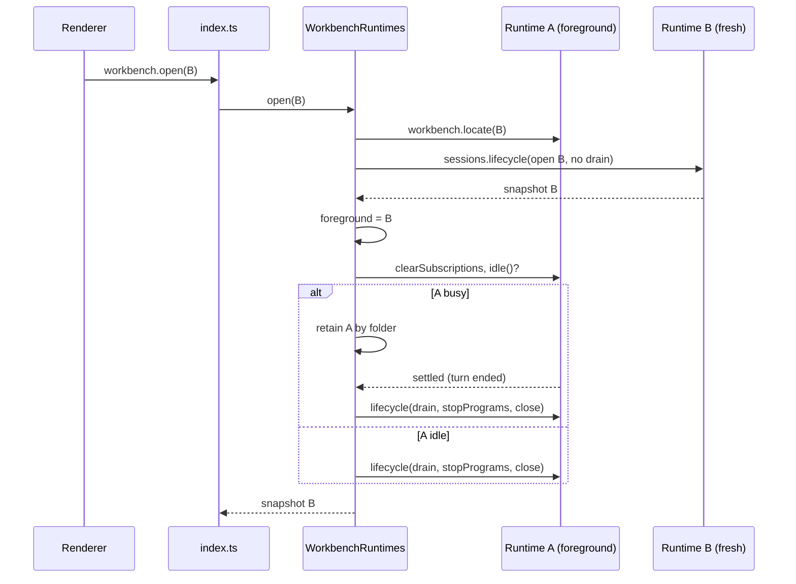
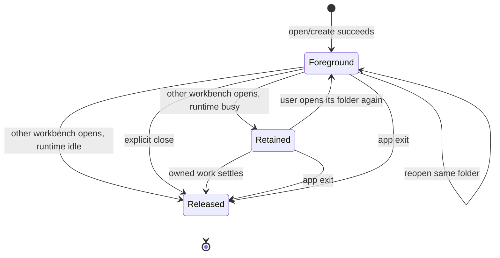

# TASK-a49f4f0c diagrams

Illustrates `## Design` in `TASK-a49f4f0c.md`. The Design text is authoritative.

Node classes: WorkbenchRuntimes = added; index.ts wiring, SessionsHost, SessionService,
WorkbenchService (locate), DisplayDocuments = changed; ProgramRunner, TerminalService = unchanged.

## Structure

## Sequence

## State

