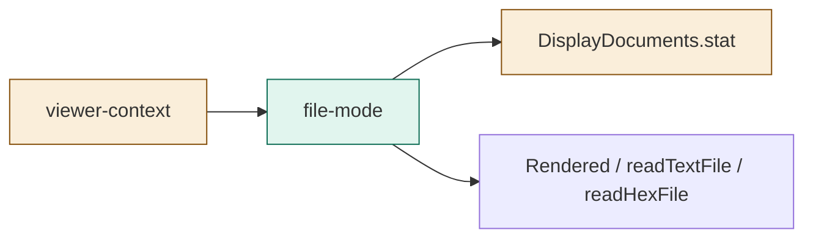
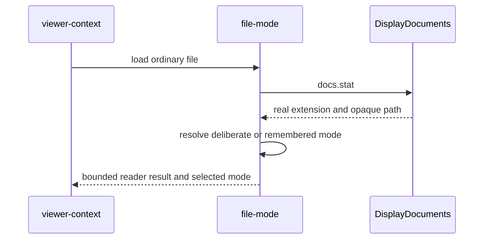
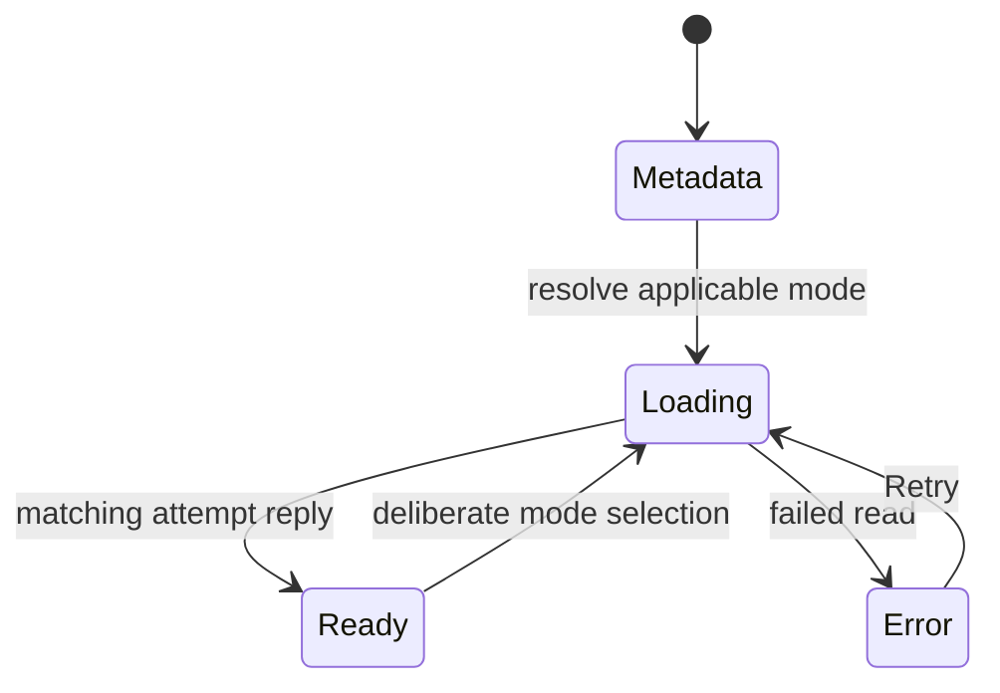

# TASK-a4d526f6 diagrams

Illustrates Design in TASK-a4d526f6.md. Design text is authoritative.

## Structure

Node map: viewer-context and DisplayDocuments changed; file-mode added; readers reused unchanged.

## Sequence

## State

