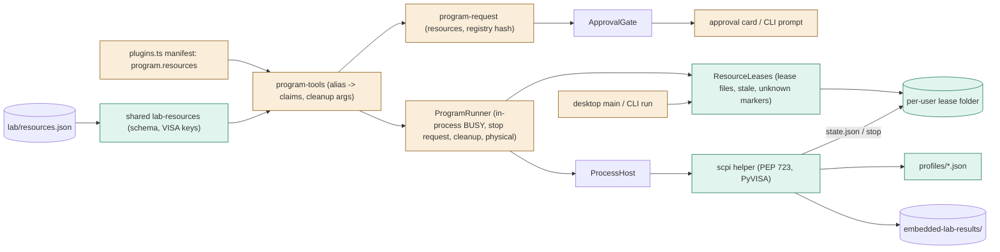
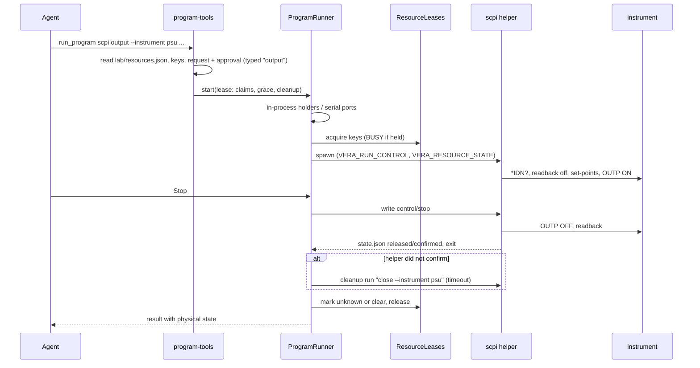
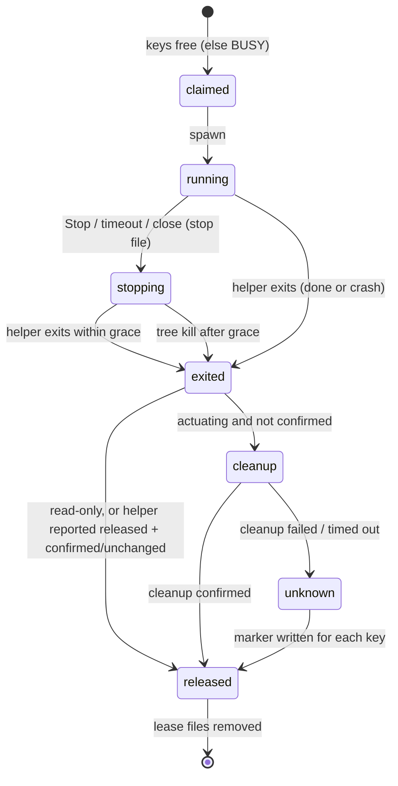

# TASK-a5a839c7 diagrams

Illustrates `## Design` in `TASK-a5a839c7.md`. The Design text is authoritative.

Node classes: added - lab-resources (shared), ResourceLeases, scpi-instruments package (scpi helper, profiles), lease
folder; changed - plugin manifest schema, program-request, program-tools, ProgramRunner, approval card / CLI prompt,
desktop and CLI composition; unchanged - ApprovalGate, ProcessHost, Provisioner.

## Structure

## Sequence

## State

