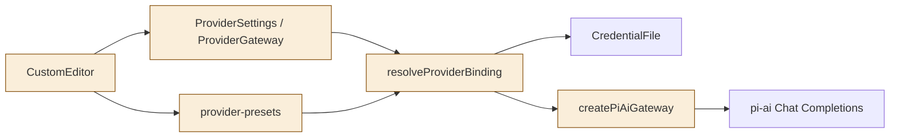
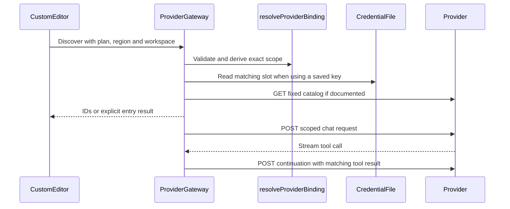

# TASK-a6ef0284 diagrams

## Structure

Changed nodes are the editor, registry, main, resolver and gateway. CredentialFile and the adapter are reused.

## Sequence

## State

The preset binding uses the existing connection lifecycle.
