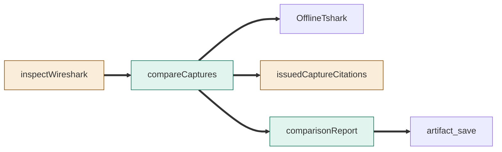
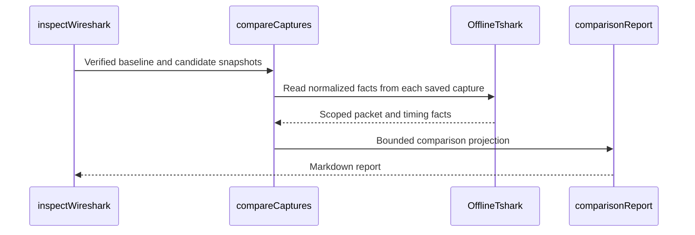

# TASK-a78209f5 diagrams

Illustrates the Design in [TASK-a78209f5.md](TASK-a78209f5.md).

## Structure

Added compareCaptures and comparisonReport. Changed inspectWireshark and issuedCaptureCitations.
Reused OfflineTshark and artifact_save.

## Sequence

## State

The comparison is a read operation with a result for one request.
