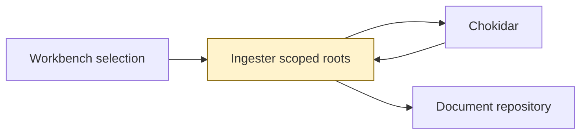
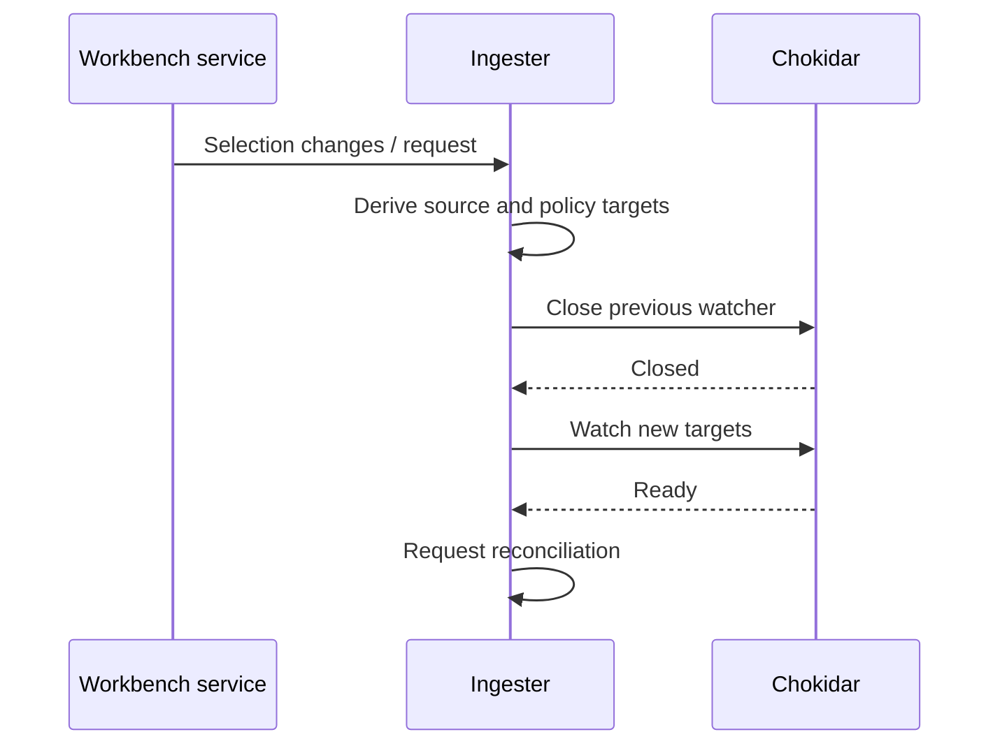
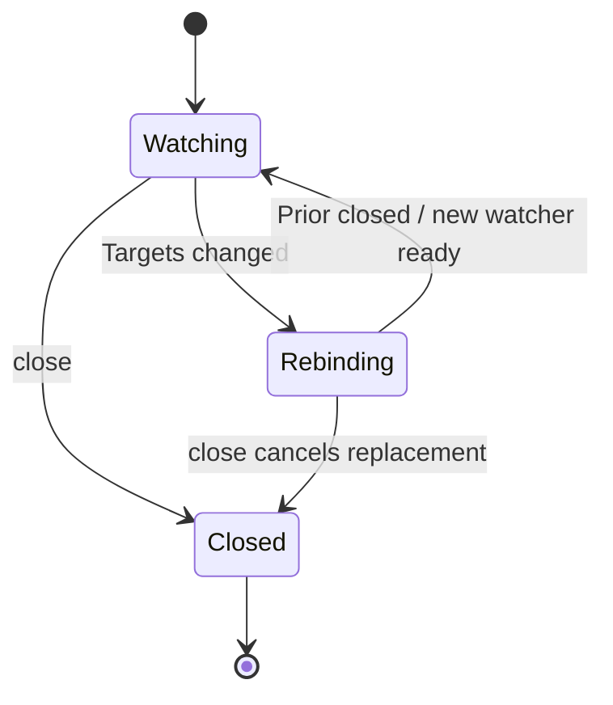

# TASK-a79bc68f diagrams

Illustrates Design in TASK-a79bc68f.md; Design is authoritative.

## Structure

Map: Ingester changed; config, Chokidar and document repository reused unchanged.

## Sequence

## State

