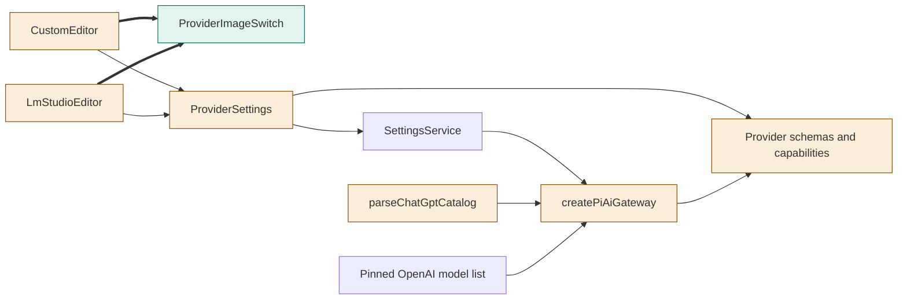
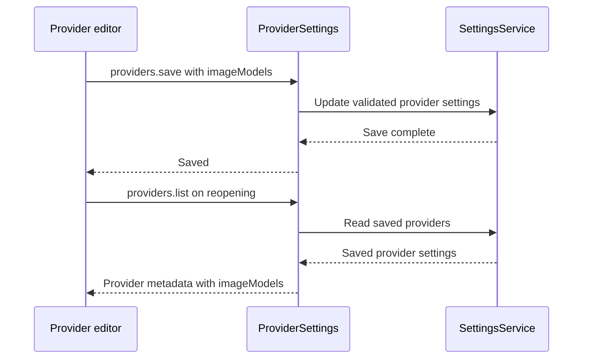

# TASK-a8070c73 diagrams

Illustrates `## Design` in `TASK-a8070c73.md`. The Design text is authoritative.

## Structure

Changed: both provider editors, ProviderSettings, provider schemas, parseChatGptCatalog and createPiAiGateway.
Added: ProviderImageSwitch. Reused: the OpenAI model list and SettingsService.

## Sequence

## State

Not drawn: the checkbox is part of the existing provider draft and save flow.
