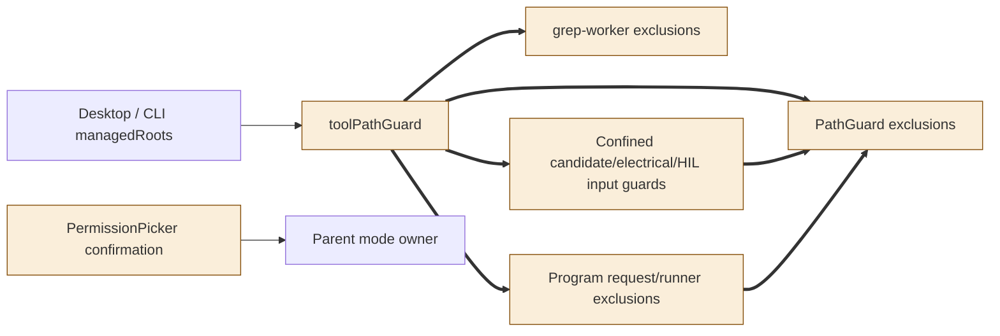
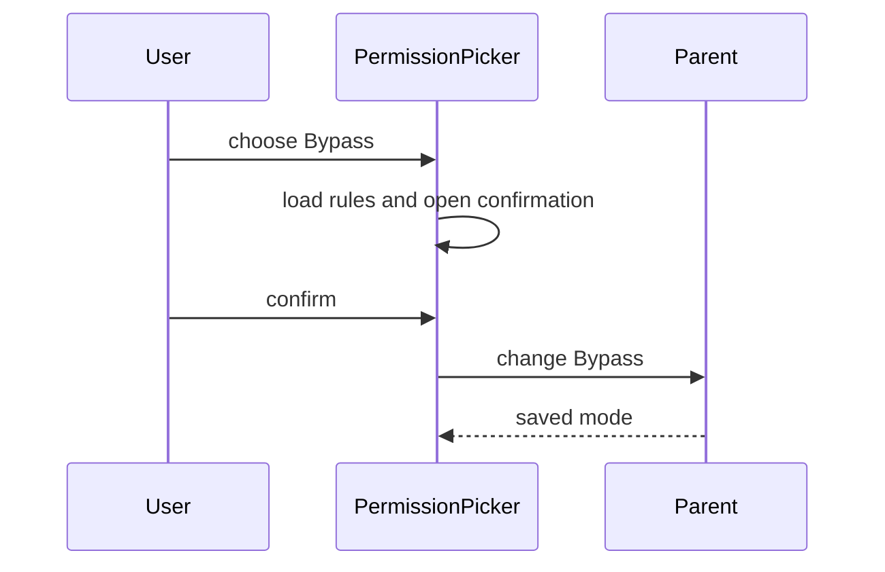
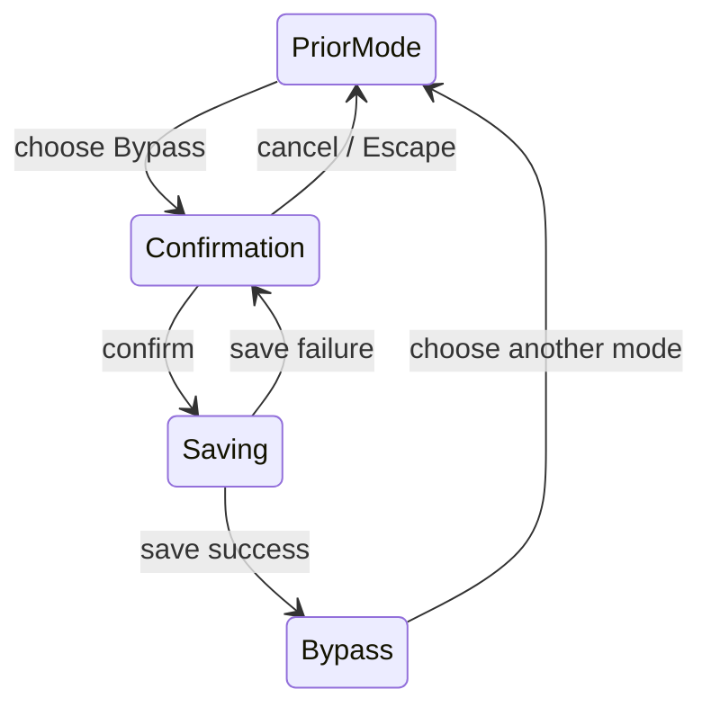

# TASK-a8bf8812 diagrams

Illustrates Design in TASK-a8bf8812.md. Design is authoritative.

## Structure

Map: toolPathGuard, PathGuard, grep-worker, confined input helpers, program guards and PermissionPicker changed; host composition and mode owner reused.

## Sequence

## State

