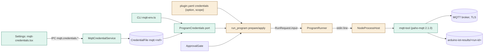
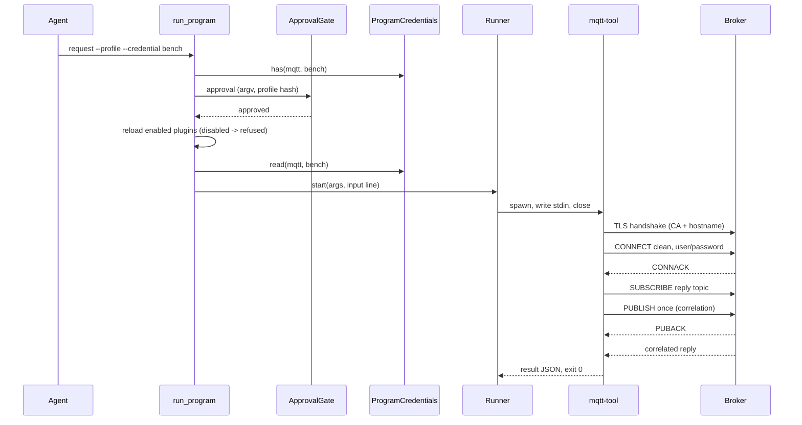
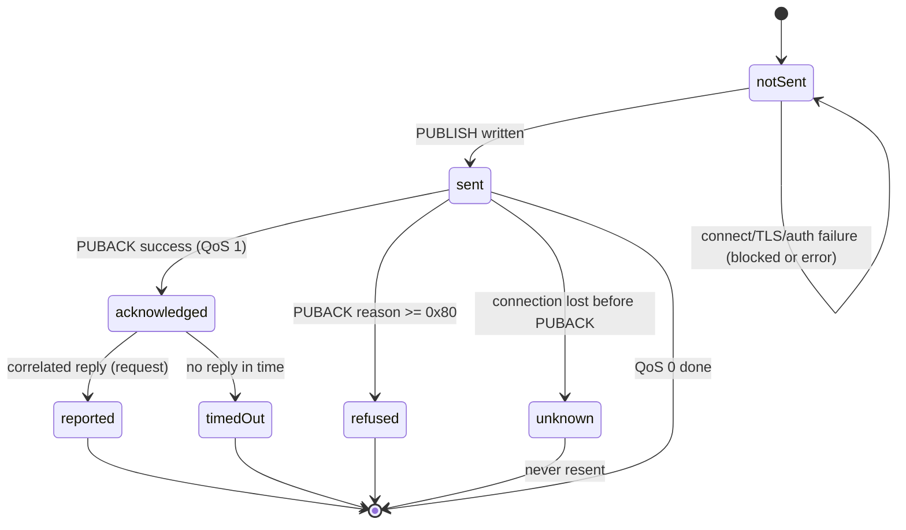

# TASK-b055791d diagrams

Illustrates `## Design` in `TASK-b055791d.md`. The Design text is authoritative.

Node classes: added = plugin mqtt-tools, mqtt_support modules, MqttCredentialService, mqtt-credentials panel,
mqtt-env, ProgramCredentials port; changed = program-tools run_program, ProgramRunner, NodeProcessHost, plugin
manifest schema, Settings page, desktop sessions/index, CLI run; unchanged = CredentialFile, approval gate.

## Structure

## Sequence

## State

