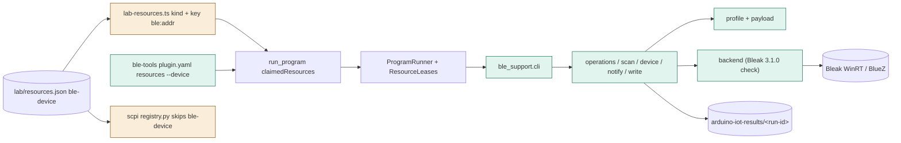
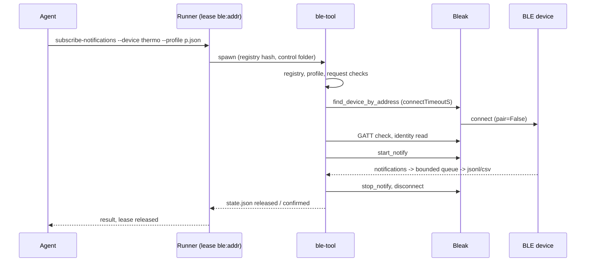
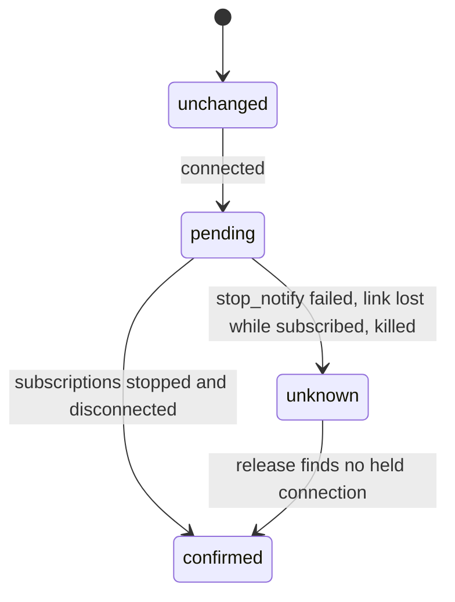

# TASK-b0622500 diagrams

Illustrates `## Design` in `TASK-b0622500.md`. The Design text is authoritative.

Node classes: added = plugin ble-tools, ble_support modules, fake Bleak; changed = lab-resources.ts (kind ble-device),
scpi registry.py; unchanged = program-tools, ProgramRunner, ResourceLeases, approval gate.

## Structure

## Sequence

## State

