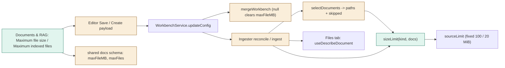

# TASK-b31773a5 diagrams

Illustrates `## Design` in `TASK-b31773a5.md`. The Design text is authoritative.

Node map: added = sizeLimit, size and count fields; changed = shared docs schema and patch,
mergeWorkbench, selectDocuments (Selection.skipped), Ingester reconcile/ingest, editor and create
payloads; unchanged = sourceLimit, useDescribeDocument (Files tab), WorkbenchService.updateConfig.

## Structure



## Sequence

```mermaid
sequenceDiagram
    participant U as Editor (renderer)
    participant S as WorkbenchService (main)
    participant G as Ingester (main)
    participant X as Indexer process
    U->>S: workbench.config.update {docs.maxFileMB, docs.maxFiles}
    S->>S: mergeWorkbench, write workbench.yaml (format 1)
    S->>G: request()
    G->>X: select {root, docs}
    X-->>G: paths, skipped (too-large), retry
    loop paths + skipped in order
        G->>G: lstat; size > sizeLimit -> unsupported / SIZE_LIMIT
    end
    G-->>U: index.document, index.volume (paths only)
```

## State

Not drawn: no new lifecycle; a skipped document uses the existing unsupported status.
